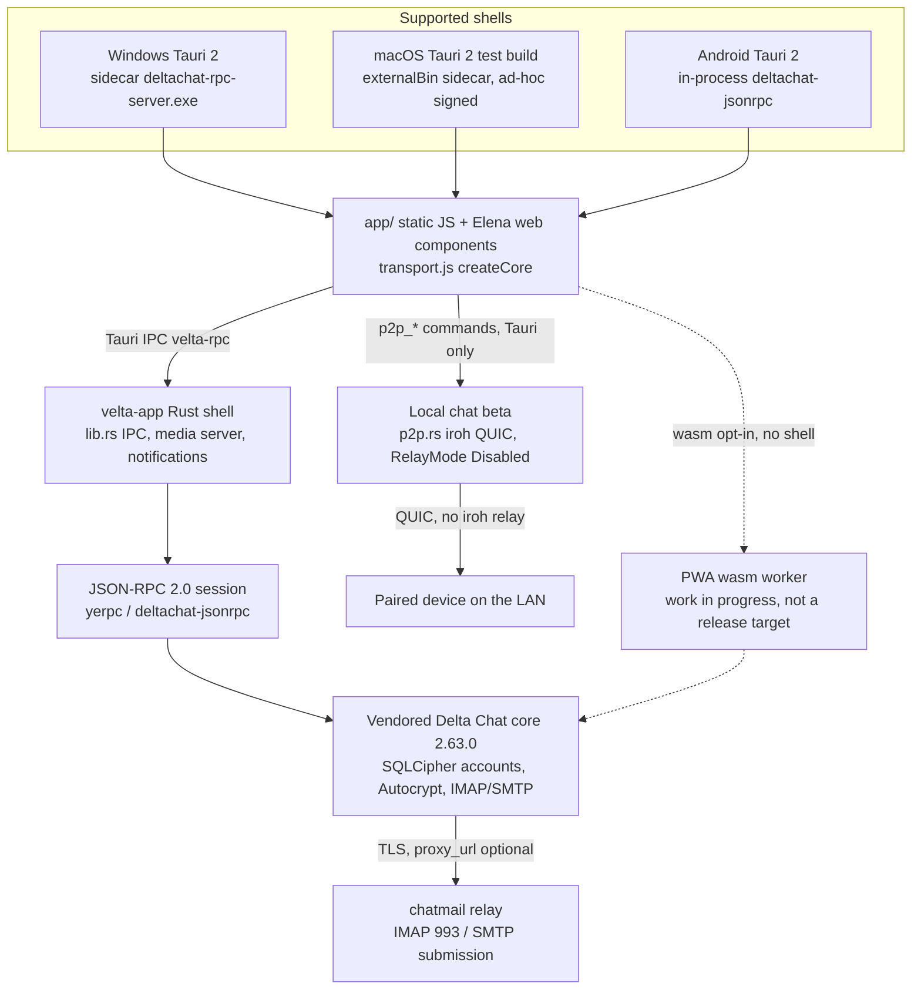
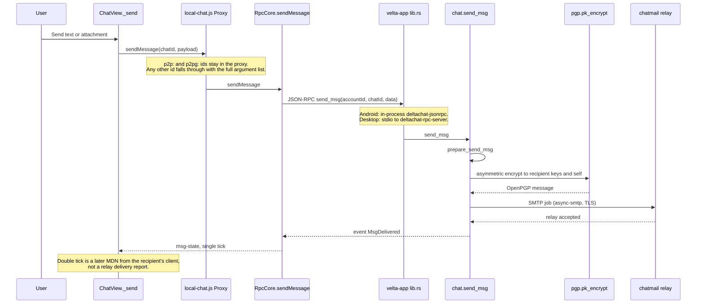
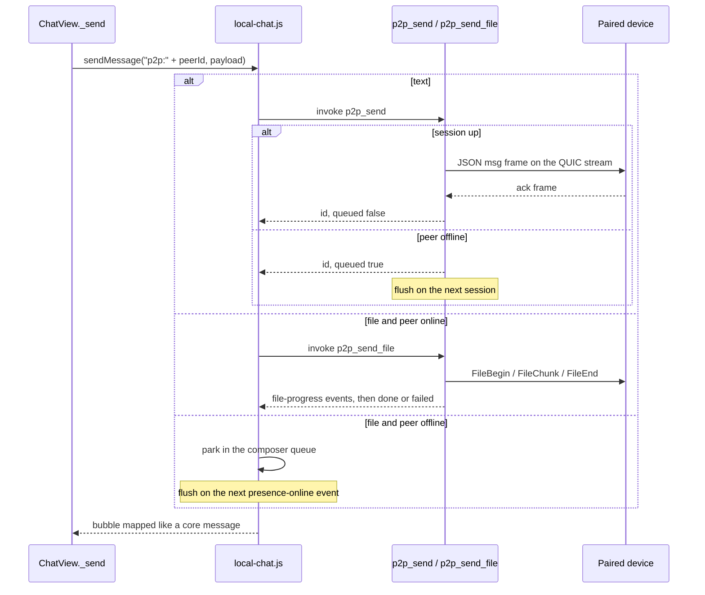

# Velta — As-Built Architecture

| | |
|---|---|
| Author | Pavel |
| Date | 2026-10-13 |
| Status | Draft |
| Checkout | `C:\Users\pave\Velta\velta` (`github.com/pbuzdin/velta`, branch `master`, HEAD `cd59531`) |
| App version | `1.4.67` (`velta-app/src-tauri/Cargo.toml`, `velta-app/src-tauri/tauri.conf.json`, `app/js/version.gen.js`) |
| Newest tag in this clone | `v1.4.65` (`d0214db`). `git describe` reports `v1.4.65-20-gcd59531`. Tags `v1.4.66` and `v1.4.67` are not present locally; the source version constant is already `1.4.67`. |
| Vendored core | Delta Chat core `2.63.0` (`core/Cargo.toml`) |
| Design system | `design/velta-design-system.html` (snapshot header says v1.4.57 / 2026-10-05; token values still match `app/css/main.css`) |

This document records the product that is in the tree at `cd59531` (app 1.4.67). It does not propose a new stack, a new mail protocol, or a rewrite. It schedules no implementation change. Chat behavior shipped after this snapshot — several gallery images, touch text selection, reaction names in message info, and the new-chat button's corners — is in AGENTS.md and the README. The no-Google-library constraint is not met: the Android release classpath still contains Material Components, and removing it requires a maintained fork of Tauri crates outside `gen/android`. That fork is not scheduled.

> **Update (post-1.4.69):** Material Components has since been removed from the Tauri APK: no app dependency, AppCompat theme parents, and a Gradle `exclude` rule strips the transitive AAR from the app runtime classpath (`-PveltaKeepMaterial=true` opts back in). `showMessageDialog` is therefore unusable on Android; shipping JS never calls it. See AGENTS.md §4.3.4. The Material statements below describe the `cd59531` snapshot.

---

## Overview

Velta is a Delta Chat client. Mail, contacts, and end-to-end encryption stay inside the vendored Delta Chat core (Autocrypt / OpenPGP as that core implements them). The UI is one static JavaScript frontend (`app/`) of HTML, CSS, and Elena web components, with no bundler and no React or TypeScript application. Supported shells are Tauri 2 on desktop and Android (`velta-app/`). Windows runs the core as a `deltachat-rpc-server` sidecar. Android links `deltachat-jsonrpc` in-process and keeps sync alive with a foreground service. macOS is the same Tauri app, shipped as an ad-hoc-signed universal test build, not a notarized product.

A second, beta, off-by-default path — local chat — pairs devices on the LAN over iroh QUIC with relays disabled. It is not a second mail crypto stack and it does not replace the core. The standalone browser PWA (including the wasm core) is work in progress and is not a supported release target.

The faceted blue V in `IMG_20260808_215950.jpg` is already the shipping launcher and PWA mark, produced by the existing `tools/generate-icons.py` pipeline. The in-app header, splash, and QR badge use a hand SVG of the same mark (`app/icons/v-logo.svg`). No Google Play Services, Firebase, FCM, APNs, StoreKit, Sentry, or analytics SDK is linked. Material Components is linked, and the no-Google-library constraint is not met. The app theme parents `Theme.MaterialComponents.DayNight.NoActionBar` and `gen/android/app/build.gradle.kts` declares `com.google.android.material:material:1.12.0`. The release graph resolves `material:1.13.0`: `tauri-plugin-dialog` 2.7.2 declares that version and `DialogPlugin.kt` `showMessageDialog` constructs `MaterialAlertDialogBuilder`. `:tauri-android` (tauri 2.11.5) and `tauri-plugin-fs` 2.5.1 also declare `material:1.7.0`. Deleting the app's `1.12.0` line and retargeting the theme parent leaves the AAR on the runtime classpath. A cargo patch or fork that would remove it is outside `gen/android` and is not scheduled.

---

## Background & Motivation

Velta exists so a Delta Chat-compatible messenger can ship without Google or Apple client SDKs and without a telemetry channel. The decisions are already recorded and are not re-opened here:

- The mail core is mandatory. Issues #29 and #31 were closed wontfix on 2026-09-30 (`AGENTS.md`, "No built-in Yggdrasil, and the chatmail core stays mandatory"). `core/src/transport.rs` is one IMAP/SMTP relay, not a plugin slot. Local chat wraps the booted core; it does not uninstall it.
- The UI is the unbundled `app/` tree. `AGENTS.md` §3 and the README ("What it is") fix the frontend as plain HTML/CSS/ES modules. Elena (`app/vendor/elena.js`, `@elenajs/core` v1.0.1) supplies `<velta-avatar>`, `<velta-chat-item>`, `<velta-chat-head>`, and `<velta-video>` (`app/js/components.js`).
- Push on Android, when a distributor is present, is UnifiedPush (`org.unifiedpush.android:connector`), not FCM. `PLAN-UNIFIEDPUSH.MD` and `UnifiedPushService.kt` are the record. The vendored core still contains APNs and FCM token helpers in `core/src/push.rs` because that file is upstream Delta Chat. Velta never obtains an FCM or APNs device token. It passes one opaque `webpush:` string from the UnifiedPush connector into `set_push_device_token` (`velta-app/src-tauri/src/lib.rs`).
- Privacy is a standing rule: zero analytics and telemetry (`AGENTS.md`, verified there against the tree on 2026-09-15, with the Windows WebView2 install bootstrapper called out as the only documented exception). A fresh search of `app/` finds no Sentry, Firebase, gtag, PostHog, or similar. The shell `Cargo.toml` has no analytics crate.

Pain that this document is not trying to redesign: chatmail is store-and-forward, so a single tick means the sending relay accepted the message and a double tick is a read receipt (`README.md`, "Message ticks"). Background delivery on Android is a foreground service plus `JobScheduler` (`BackgroundFetchJob.kt`) plus optional UnifiedPush, not Play Services. The browser product that would host the core in wasm behind a websocket relay is unfinished on purpose.

---

## Goals & Non-Goals

### Goals

1. Describe the shipping architecture with the files that implement it.
2. Check the product constraints against the code and say, for each one, met or not met.
3. Bind UI work to the principles in `design/velta-design-system.html` (`#principles`). This document schedules no UI change, so the map below is against the shipping CSS.
4. State how `IMG_20260808_215950.jpg` becomes the app mark, using the pipeline that already exists.
5. Keep observability local. Do not add a metrics pipeline.

### Non-goals

- A second cipher, a second mail protocol, or a Yggdrasil node inside the app.
- A React, TypeScript, or bundler rewrite of `app/`.
- Expanding local chat (new frame types, calls, voice, a relay). The beta limits below are the product.
- Promoting the browser PWA to a supported release shell.
- An iOS app. `capabilities/mobile.json` lists `"platforms": ["android", "iOS"]` because that is how the Tauri mobile capability file is scoped. There is no iOS shell in this checkout.
- Regenerating icons, cropping the logo, a monochrome reduction, or putting the JPEG in the header, splash, or QR badge. Those chrome slots stay `app/icons/v-logo.svg`. The macOS bundle keeps the existing `icons/icon.icns`: do not extend `tools/generate-icons.py` and do not regenerate `.icns`. Both are closed decisions (Key Decisions 9 and 11).
- A visual sweep of pre-existing CSS literals. Those are named under the design-system map and are not scheduled.
- Removing the `google()` Maven repository entries. Those are how the Android Gradle Plugin resolves AndroidX. They are not a Play Services API.
- Forking or patching `tauri-plugin-dialog`, `tauri`, or `tauri-plugin-fs` to drop Material Components. That fork is what would take the library off the release classpath. It is a product decision about tracking Tauri upgrades, and this document does not schedule it.

---

## Proposed Design

### Context

Release sizes quoted by the README for `1.4.67`: Android arm64 APK about 49 MB, Windows x64 installer about 13 MB, macOS universal DMG about 36 MB. `rust-version = "1.89"` in `core/Cargo.toml` and `velta-app/src-tauri/Cargo.toml` is the minimum supported Rust for those two crates. Neither crate ships a `rust-toolchain.toml`, so 1.89 is an MSRV, not a pinned compiler. The unfinished wasm worker in the diagram is the one path that does pin a compiler: `packages/velta-wasm/rust/rust-toolchain.toml` sets `nightly-2026-08-01` with target `wasm32-unknown-unknown`.

### Shells and how the core is reached

`app/js/transport.js` `createCore()` picks a backend. `localStorage["velta-mock"] === "1"` short-circuits to `mock-core.js` (dynamic import, not in the production import graph). Otherwise, in order:

1. `window.VeltaBridge` — an in-WebView bridge. No shipping shell sets it. Android boots through Tauri. `AGENTS.md` §4.3 already marks this probe as dead. Left as-is.
2. `window.__TAURI__` — the supported path. The page sends JSON-RPC lines with the `rpc` command. Responses and core events come back on the `velta-rpc` event (`lib.rs`).
3. Wasm worker, only when `wasmOptIn()` is true and neither `VeltaBridge` nor `__TAURI__` is set (`transport-worker-wasm.js`, `worker-wasm.js`). The C4 dist sets `window.VELTA_PWA.wasmCore`. This is the unfinished browser product.
4. `MockCore` if nothing connects within 20 seconds.

Desktop core process:

- Windows bundles `binaries/deltachat-rpc-server-x86_64-pc-windows-msvc.exe` as `deltachat-rpc-server.exe` (`tauri.conf.json` `bundle.resources`). `find_sidecar` in `lib.rs` spawns it. Stderr goes to `sidecar-stderr.log` next to `velta.log`.
- macOS uses `bundle.externalBin` in `tauri.macos.conf.json` instead, so the Windows PE is not packaged into the `.app`. Signing identity in config is ad-hoc (`"-"`). No notarization, no StoreKit, no Apple Push capability in the Velta shell.

Android core process:

- `deltachat-jsonrpc` is a path dependency of the `android` target in `velta-app/src-tauri/Cargo.toml`. The core runs inside the APK. There is no sidecar.
- `org.velta` (`tauri.conf.json` `identifier`). minSdk 24, targetSdk 36 (`gen/android/app/build.gradle.kts`).
- Incoming notifications are posted from Rust (`bg_notify_incoming` in `lib.rs`) through JNI into `Notifications.kt`, which builds `androidx.core.app.NotificationCompat.MessagingStyle`. That is the AndroidX wrapper over `android.app.Notification`, the platform shade. It is not Firebase Cloud Messaging and it does not use Play Services.
- While the process is frozen, `BackgroundFetchJob` (`android.app.job.JobScheduler` / `JobService`) wakes the process and calls the same JNI `pushWakeup` the UnifiedPush path uses. `JobScheduler` is a platform API.
- A partial wake lock and a foreground data-sync service keep IMAP idle while the user has allowed background work. The README describes the 15-minute scheduled fetch and the 90-second background poll. Doze still wins until the user grants unrestricted battery use; Velta asks via the platform battery-exemption intent, not via a Google library.
- Share-in uses `ACTION_SEND` / `ACTION_SEND_MULTIPLE` on `MainActivity`. Export of a profile backup uses the platform create-document dialog (`plugin:dialog|save`), then `publish_backup` copies the core's `.tar` onto the returned content URI. `ContentResolver` (`jni` crate, `resolve_content_uri`) copies `content://` picks into app-local storage because the core cannot read those URIs. These are Android framework APIs.

### Frontend

There is no `package.json` for `app/` and no compile step. `index.html` loads `ui-scale.js` and `boot-net.js` as parser-blocking scripts, `vendor/virtual-scroller.js` as `defer`, then ES modules. CSP is in both `index.html` and `tauri.conf.json` and does not allow remote script hosts.

`app/js/rpc-core.js` is the JSON-RPC client: account epoch isolation, a long-poll that starts as `get_next_event_batch` with a 240-second client backstop (`EVENT_POLL_TIMEOUT_MS = 240_000`) and falls back to `get_next_event` only when the core returns method-not-found (`-32601`, or a message matching "method not found" / "unknown method"), and the method surface the UI calls (`send_msg`, `get_message`, `markseen_msgs`, and the rest of the core API the UI actually uses). When `get_event_reader_mode` returns `"rust"`, the Android shell is the single event reader and the page does not start that poll (`_pollEvents` in `rpc-core.js`). `mock-core.js` mirrors the method surface for demo mode. `app/js/chat-view.js` owns the virtualized history and the composer. `app/js/app.js` owns the chat list, navigation, splash, and deeplinks.

Account data never lives in a Velta-operated database. It lives in the core's SQLCipher sqlite under the app-local accounts directory (`rusqlite` feature `sqlcipher`, and `bundled-sqlcipher-vendored-openssl` on the Windows sidecar build). UI preferences that are not core config live in `localStorage` (theme, UI scale, chat category, local-chat opt-in, read markers).

### Mail encryption — the only cipher for mail

Velta does not implement a cipher. Outgoing mail is `ChatView._send` → `core.sendMessage` → JSON-RPC `send_msg` → `chat::send_msg` in `core/src/chat.rs`.

`send_msg` calls `prepare_send_msg`, which renders the message in `core/src/mimefactory.rs`. For a normal encrypted chat the arm is `QueuedEncryption::Asymmetric`, which calls `pgp::pk_encrypt` (`core/src/pgp.rs`). That function is rPGP (`pgp` crate 0.21). The comment on `create_keypair` states the Autocrypt key shape: an Ed25519 signing primary key and a Curve25519 ECDH subkey. The symmetric algorithm constant in that file is AES-128. SEIPD v2 is used when every recipient key supports it, otherwise v1. The message is always encrypted to self. A symmetric shared-secret arm exists for the core's own group secret; Velta does not add one.

The SMTP scheduler (`core/src/smtp.rs`, plus the Velta quilt ops #10 and #11) submits the rendered message to the profile's chatmail relay. IMAP (`core/src/imap.rs`) receives. Quilt ops on this checkout, applied only through `tools/apply-core-patches.py`, are the send-transport exposure, the "Use for sending" pin, a 10-second bound on `background_fetch`, push-token accepted/rejected events, and (#14) the reply-thread queries `get_reply_counts` / `get_reply_ids` in `chat.rs` with thin jsonrpc wrappers in `api.rs`. They do not replace OpenPGP.

Unencrypted 1:1 mail (a classic email contact the relay cannot encrypt to) is the core's plaintext arm. The UI marks it with an open-shackle lock. Encrypted chats show no lock (`README.md`).

`RpcCore.sendMessage` (`app/js/rpc-core.js`) sends both camelCase and snake_case view-type and quote fields because serde on the two core generations ignores the casing it does not know. It tracks the id for the relay-line dashes, then polls `get_message` until state leaves `OutPreparing` (18), up to 6 seconds, so the bubble gets the real view type after the core copies the blob. Attachment bytes are a filesystem path the core can read: a desktop path copied into `AppLocalData/uploads/`, or an Android `content://` URI copied the same way. The core's recommended raw attachment size is about 18 MB (`README.md`); Velta does not enforce a second limit on the mail path.

Relay hostnames are whatever the user configured (invite link, domain, or the core's built-in pool via `init_transports`). This document does not name a private relay. A placeholder, when one is required, is `relay.example.org`.

### Local chat (beta) — real, and limited

Engine: `velta-app/src-tauri/src/p2p.rs`. UI card and pairing: `app/js/p2p.js`. Chat-list integration: `app/js/local-chat.js`, a `Proxy` around whatever core object booted. Commands are Tauri `p2p_*` handlers registered in `lib.rs`. A debug binary `p2p-hub` exists behind the `p2p-hub` feature and is not in release bundles.

The engine sets iroh `RelayMode::Disabled` (`p2p.rs`, endpoint build) and enables `discovery-local-network` (mDNS) from `Cargo.toml`. Transport encryption is the QUIC TLS iroh already uses. The long-term identity is an ed25519 key in `<AppLocalData>/p2p/identity.key`; the NodeId is that public key. Pairing is a `VELTAP2P1:` ticket (NodeId, direct addresses, one-time token) shown as a QR, or a nearby tap that carries no token and must be approved in the UI. LAN beacons (UDP port 53717, per `docs/agents/p2p.md`) carry names and addresses only. Frames from an unpaired NodeId are rejected. This is the local-chat security model. It is not Autocrypt, and mail does not travel over it.

Disabled by default. `P2pState` starts off, and `spawn_startup` will not open a socket unless `p2p_set_enabled(true)` runs. The page calls that only when `localStorage["velta-p2p"] === "1"` (`p2p.js`). A fresh install does not beacon.

Limits that are already enforced, and that this document does not lift:

| Limit | Where |
|---|---|
| Off unless the user turns it on | `p2p.rs` startup gate, drawer in `p2p.js` |
| Tauri shells only for the real engine | `local-chat.js` `isTauri()`; the browser path is an in-page simulator |
| 1:1 text and files up to 256 MB | `p2p.rs` file frames, base64, 96 KB raw per frame |
| Groups: you plus up to 4 peers (5 devices) | `p2p.rs` `groups` module, `MAX_GROUP_MEMBERS` |
| Group files up to 32 MB, online members only | README "Local groups"; offline members get no file |
| No voice messages, no audio calls, no edit | README; composer hides the items; `chat-view.js` does not offer Resend-via-core on `isP2p` |
| Text to an offline peer is queued in the engine | `p2p_send` returns `{id, queued}` |
| Media to an offline 1:1 peer waits on `p.queue`. The tray chip `#lc-queue-chip` is created in `app.js` | `local-chat.js` `sendMessage` pushes the file when `p.online === false`. `app/js/app.js` creates the element (`getElementById("lc-queue-chip")`). CSS is `app/css/main.css` |
| No resume of a failed file transfer | retry sends the stored copy from byte zero |
| Typing hints are live only | `app/js/typing.js`, not stored |
| ALPN `/velta/p2p/2` then `/velta/p2p/1` | a v2-only frame must not be sent on a v1 session |

`p2p:` is 1:1. `p2pg:` is a group. The group prefix does not start with `p2p:`, so 1:1 branches stay 1:1. Deleting a local chat calls `removePeer` / the engine, not core `delete_chat`. A string id must not reach the core.

Group send is `sendGroupMessage` in the same proxy, fan-out between member NodeIds, creator-signed membership. A tick becomes double only when every current member has the message. That path is real and is not redesigned here.

### Calls, webxdc, and other core features (as built)

Audio calls (beta) use the core for signaling: offer and answer SDP ride in encrypted messages, and the core hands back the relay's STUN/TURN servers. Media is a WebRTC `RTCPeerConnection` in the WebView (`app/js/calls.js`). No group calls. No call signaling on local chat. The microphone is a platform permission (`RECORD_AUDIO` on Android, a WebView2 launch flag on desktop, TCC usage strings on macOS). WebRTC in the WebView is not an Apple or Google communications SDK.

webxdc mini-apps render in an opaque-origin sandbox iframe (`app/js/webxdc-manager.js`) without `allow-same-origin`. State sync is the core's encrypted status updates. Realtime channels are not wired.

The optional Android DNS tunnel (`velta-app/src-tauri/src/tunnel.rs`, `velta-app/soar-tunnel`) loads `libsoartunnel.so` only after the user accepts a `velta://tunnel` link. It sets the core's existing `proxy_url` (HTTP CONNECT, SOCKS5, or Shadowsocks — `core/src/net/proxy.rs`). Velta ships no tunnel server. A proxy the user set themselves wins. This is not a Google or Apple API. The operator of the tunnel can see which relays are contacted and when; the README says so.

### Logo

Source file: `IMG_20260808_215950.jpg` at the repo root. It is a square navy field with a faceted light-blue V and a soft ground shadow. `app/icons/icon-192.png` is that same picture, padded and scaled. The pipeline that produces the shipping rasters is `tools/generate-icons.py`. Its default argument is `IMG_20260808_215950.jpg`. It uses Pillow and vtracer, which are already dev-time tools of that script. Do not add another icon generator.

What the script writes, and who consumes it:

| Output | Size / form | Consumer |
|---|---|---|
| `app/icons/velta-logo-src.png` | 1024, center-cropped to square | master copy, also the vtracer input |
| `app/icons/icon-192.png`, `icon-512.png` | padded on the dark field (`make_padded`, scale 0.72) | `index.html` favicon, `manifest.webmanifest`, notification icon in `ui.js` |
| `app/icons/maskable-512.png` | extra 80% safe-zone pad, background `#0f0f14` | manifest `purpose: maskable` |
| `app/icons/icon.svg` and `velta-app/src-tauri/icons/icon.svg` | vtracer color trace of the 1024 PNG | not the in-app header |
| `velta-app/src-tauri/icons/32x32.png`, `128x128.png`, `128x128@2x.png`, `icon.png` (1024) | padded rasters | `tauri.conf.json` `bundle.icon` |
| `velta-app/src-tauri/icons/icon.ico` | 16, 24, 32, 48, 64, 128, 256 | Windows |
| Android `mipmap-*/ic_launcher.png`, `ic_launcher_round.png`, `ic_launcher_foreground.png` | mdpi 108 through xxxhdpi 432, foreground with the sampled background knocked out | `AndroidManifest` `@mipmap/ic_launcher`, adaptive XML written by the same script |

The script does **not** write `icon.icns`, `icons/ios/*`, or the `Square*Logo.png` / `StoreLogo.png` tiles. Those files are already in `velta-app/src-tauri/icons/`. Decided: leave the existing `icon.icns`. Do not extend `tools/generate-icons.py` and do not regenerate `.icns`. `tauri.macos.conf.json` keeps pointing at the current `icons/icon.icns`. The `ios/` set and the Square tiles have no shipping shell: there is no iOS target and no Microsoft Store package. Leave them as they are. No new library.

In-app mark, left as-is: `app/icons/v-logo.svg` (hand vector, title "Velta V logo", gradients, about 2.8 KB). It is not a trace of the JPEG (`icon.svg` is the trace, and the UI does not use it for chrome).

| Surface | File | Size |
|---|---|---|
| Sidebar | `app/index.html` `.sidebar-logo` | CSS height 38px (`app/css/main.css`). The comment there says the glyph covers about 57% of the viewBox, so 38px CSS yields about a 22px visible V. |
| Splash | `app/js/app.js` `.splash-logo` | 132×132 CSS (`main.css`) |
| Profile-backup QR and invite QR | `app/js/ui.js`, `app/js/app.js` | `.qr-self` badge |
| Local-chat invite QR | `app/js/p2p.js` | same badge, centered |

Decided: `IMG_20260808_215950.jpg` stays the launcher, favicon, maskable icon, and Windows icon, produced by `tools/generate-icons.py`. Header, splash, and QR badge stay `app/icons/v-logo.svg`. No crop, no monochrome reduction, and no photograph in those chrome slots.

### Design system

Binding principles are the list under `#principles` in `design/velta-design-system.html`. The shipping theme system is the three `html[data-theme]` blocks in `app/css/main.css`: default (`:root`, dark), `light`, and `brutal`. `design/experiment-soviet-brutalism.html` is an experiment. The app does not load it. Do not add a second theme system.

| Principle | Where the app follows it | Drift, not scheduled |
|---|---|---|
| No pure black or white. Dark canvas `#0f0f14`, ink `#f2f2f5`; light `#f4f4f4` / `#16181d`; brutal ink `#121017`, not `#000`. | `:root`, `html[data-theme="light"]`, `html[data-theme="brutal"]` in `main.css`. Brutal's own comment repeats the rule. Manifest `background_color` / `theme-color` are `#0f0f14`. | `html[data-theme="light"] .webxdc-frame { background: #fff }` is a surface. `.share-account.current` and `.call-btn.accept` / `.call-btn.danger` set `color: #fff` (ink on a filled control, not a page surface). `rgba(255,255,255,…)` hovers are translucent overlays, which the token `--bg-hover` already is. |
| Contrast carries the hierarchy. AA body pairs; light accent 3.01 accepted as UI-only. | Token table in the design-system file matches `main.css`. Outgoing-bubble links use `#dfeaf6` / `#14507e`, not `--accent` (`AGENTS.md` bubble-contrast rule, `main.css` `.msg-row.out .msg-text a`). | None new. The accepted light-accent exception stays accepted. |
| Accent is a verb. Status uses `--green` and `--danger`. Timestamps use `--text-meta-in` / `--text-meta-out`. | `:root` tokens. Relay segments use their own greens, ambers, reds, and greys (`.relay-seg[data-state]`), not `--accent`. | Active category chip (`.chat-cats button.active`) paints `--accent` as the selected filter. That is an action state, same family as the principle's "actions, links, unread". Left as-is. |
| Hover changes surfaces, never text. Touch has no hover. | `.icon-btn:hover`, `.bar-btn:hover`, `.chat-item:hover`, `.ctx-item:hover` set `background: var(--bg-hover)` inside `@media (hover: hover) and (pointer: fine)`. | Text color does change on hover for `.chat-cats button`, `#btn-sticker`, `.toast-copy` / `.toast-undo` / `.toast-close`, `.invite-copy`, `.diag-copy`, and `.pin-unpin` (the last also sets a background and moves to `--danger`). Brutal `.icon-btn:hover` and `.bar-btn:hover` set `color: var(--nb-main-ink)` because the surface becomes `#e0b52f`; leaving light text there would fail the contrast principle. That brutal swap is required, not drift. |
| One stack, one grid. System UI font, no webfont. 2px grid. | `body` font stack in `main.css` is the system stack from the design system. No `@font-face` in `app/`. Spacing tokens and the 2026-10-05 rhythm audit live in the design-system file; snap commits are already in `main.css`. | The audit's remaining micro-values (bubble `7px 10px 6px`, media bleed `±5px`, pin-tray 9px radius) are marked deliberate there. Not reopened. |
| Dark is the primary theme. Light derives from it. Brutal is dark-only. | `:root` is dark. Light and brutal only override the tokens they change. Brutal does not have a light variant. Default for a fresh install is Auto, which follows `prefers-color-scheme` (`README.md`, drawer in `app/js/ui.js`). | None. |
| The shell owns scaling. `text-size-adjust: 100%`, Android `textZoom` 100, `applyUiScale`, safe-area insets. | `html { text-size-adjust: 100% }` in `main.css`. `MainActivity.kt` `textZoomFix` sets `wb.settings.textZoom = 100`. `app/js/ui-scale.js` applies `zoom` from `localStorage["velta-ui-scale"]` before first paint; `applyUiScale()` in `ui.js` is the drawer control (0.85 / 1 / 1.15). Headers use `env(safe-area-inset-top)`. | `index.html` also sets `user-scalable=no`. That is the same "no OS text inflation" rule, already audited in `docs/web-components-audit.md`. Not a new theme system. |

`html[data-theme="brutal"]` is the shipping brutal theme: flat panels, 2px `--nb-ink` borders, hard offset shadow `4px 4px 0 #121017`, `--radius-bubble: 6px`, outgoing bubble and selected row on `#e0b52f` with `--nb-main-ink`. Any later UI work uses these tokens. It does not invent a parallel brutal stylesheet.

The principles are binding for later UI work. This document schedules no PR and does not touch `app/css` or `app/js`. The drifts in the right-hand column are recorded so they are not rediscovered as surprises. They stay unscheduled: a hover-color sweep would be busywork against an audit that already accepted the leftovers, and the unmet constraint is the Android Material classpath, not these CSS literals.

### Platform APIs that are not Google or Apple SDKs

| API | Where | Why it is not a banned SDK |
|---|---|---|
| `android.app.Notification` via AndroidX `NotificationCompat` | `Notifications.kt` | Platform shade. AndroidX is the Jetpack support library already required by the Tauri shell. No FCM. |
| `JobScheduler` / `JobService` | `BackgroundFetchJob.kt` | Platform scheduler. |
| `ContentResolver`, `ACTION_SEND`, `ACTION_CREATE_DOCUMENT` | `lib.rs` JNI, `MainActivity.kt`, backup export | Platform file and share sheet. |
| Custom Tabs (`androidx.browser:browser`) | `InAppBrowser.kt` | AndroidX. The code resolves a `CustomTabsService`. The candidate package list includes Chrome, Firefox, Edge, Samsung Internet, Brave, and Opera. A string `"com.google.android.apps.chrome"` is one candidate name, not a linked Google library. If no provider exists, a second `android.webkit.WebView` is used. |
| `android.webkit.WebView` `textZoom`, wake lock | `MainActivity.kt` | Platform WebView. |
| UnifiedPush connector `org.unifiedpush.android:connector:3.3.4-rc1` | `UnifiedPushService.kt` | A third-party distributor the user installed (ntfy, NextPush, …). Not Play Services. The token sent to the core is `webpush:<url>\|<pubkey>\|<auth>`. |
| Windows `tauri-winrt-notification` | `Cargo.toml` `[target.'cfg(windows)']` | WinRT toasts. Not Apple, not Google. |
| WebView2 bootstrapper | `tauri.conf.json` `webviewInstallMode: downloadBootstrapper` | Microsoft Edge WebView2 installer. The documented privacy exception in `AGENTS.md`. Not a Velta analytics channel. |
| macOS ad-hoc signature, `Info.plist` microphone/camera strings, hardened-runtime entitlements | `AGENTS.md` §4.3.2 | OS packaging so Gatekeeper and TCC can show a prompt. No Apple Developer API, no StoreKit, no APNs entitlement in the Velta shell. |
| `google()` in Gradle | `gen/android/build.gradle.kts` | Maven repository hostname used by the Android Gradle Plugin to download AndroidX. Not a runtime API. |
| `com.google.android.material:material` | App line: `gen/android/app/build.gradle.kts` declares `1.12.0`, and both `themes.xml` files parent `Theme.MaterialComponents.DayNight.NoActionBar`. Transitive: `gen/android/app/tauri.build.gradle.kts` compiles `:tauri-plugin-dialog`, `:tauri-android`, `:tauri-plugin-fs`, and `:tauri-plugin-opener` from the cargo registry paths in `gen/android/tauri.settings.gradle`. `tauri-plugin-dialog` 2.7.2 declares `material:1.13.0`, and `DialogPlugin.kt` `showMessageDialog` constructs `MaterialAlertDialogBuilder`. tauri 2.11.5 (`mobile/android/build.gradle.kts`) and `tauri-plugin-fs` 2.5.1 declare `material:1.7.0` and do not import a Material type. `tauri-plugin-opener` 2.5.4 does not declare Material. The last `universalRelease` report `gen/android/app/build/outputs/sdk-dependencies/universalRelease/sdkDependencies.txt` resolves `com.google.android.material:material:1.13.0`. Release `isMinifyEnabled` and `isShrinkResources` are both false, so the AAR is packaged. | **This one is a Google library, and it is linked.** No `org.velta` Kotlin inflates a Material widget. Shipping JS calls `plugin:dialog|open` and `plugin:dialog|save` only (`app.js`, `chat-view.js`, `webxdc-manager.js`), not `showMessageDialog`. That does not keep the resolved `1.13.0` AAR off the runtime classpath. The library stays. See the gap list. |
| Upstream `core/src/push.rs` APNs and FCM helpers | vendored core | Compiled into the core because the core is vendored whole. Velta's only caller passes a UnifiedPush `webpush:` token. Do not start calling the Apple or FCM setters. |
| `androidTestImplementation` Espresso | `build.gradle.kts` | Test classpath only. Not in the release APK. Not scheduled for removal. |

---

## API / Interface Changes

No mail, RPC, UI, or Android theme changes. The core JSON-RPC methods the page already calls stay the contract (`RpcCore.sendMessage` → `send_msg`, and the rest of `rpc-core.js`).

An earlier draft of this document proposed deleting `implementation("com.google.android.material:material:1.12.0")` and parenting `Theme.velta_app` on `Theme.AppCompat.DayNight.NoActionBar`. That edit is withdrawn. `androidx.appcompat:appcompat:1.7.1` is already an `implementation` dependency, and the style items in both `themes.xml` files are `android:` window attributes, but retargeting the parent does not remove the library. `tauri.build.gradle.kts` still compiles `:tauri-plugin-dialog`, whose own Gradle file requests `material:1.13.0`, and the last `universalRelease` resolve is already `1.13.0`. `MaterialAlertDialogBuilder` needs a Material Components theme (or an overlay that defines the Material dialog attributes). An AppCompat parent drops `materialAlertDialogTheme`, so a later message or ask dialog fails even though today's JS never calls `showMessageDialog`. `themes.xml`, `build.gradle.kts`, and `tauri.build.gradle.kts` are `cargo tauri android init` output. A comment inside those files is deleted by the next init and is not a durable hook.

Added since (2026-10-22, quilt op #14): two read-only JSON-RPC methods, `get_reply_counts(account_id, chat_id)` → `{quoted msg id: count}` and `get_reply_ids(account_id, chat_id, message_id)` → reply ids oldest first. Both match `msgs.mime_in_reply_to` against the quoted message's `rfc724_mid`, scoped to the chat on both sides; no schema change. `rpc-core.js` exposes them as `getReplyCounts` / `getReplyIds`; older cores fall back to loaded-window counts. See `docs/reply-threads.md`.

Local-chat and mail interfaces stay as they are. Do not add a method that sends mail through `p2p_send`, or a method that sends a `p2p:` id into `send_msg`.

---

## Data Model Changes

None. Existing stores, for orientation:

| Store | Path | Owner | Contents |
|---|---|---|---|
| Account database | app-local `accounts/` (`get_accounts_dir`) | Delta Chat core, SQLCipher | Keys, chats, messages, blobs. Windows data dir is the Tauri app-local dir; macOS is `~/Library/Application Support/org.velta/` (README). |
| P2P identity | `<AppLocalData>/p2p/identity.key`, `profile.json`, `peers.json`, `messages-<node_id>.jsonl` | `p2p.rs` | ed25519 secret, display name, peers, 1:1 history. Not inside the core database. |
| P2P blobs | `<accounts>/p2p-blobs/<nodeId>/` | `p2p.rs` | Must stay under the accounts directory so the media server and `blobfile://` allow the read. Peer file names are basenames only. |
| UI prefs | `localStorage` keys `velta-ui-scale`, `velta-p2p`, `velta-chat-category`, theme, read markers, … | page | Not synced. Read markers are per device (`app/js/read-markers.js`). |
| Logs | see Observability | shell | Not an account store. |
| Push token | core config, written by `set_push_device_token` | core, value from UnifiedPush | Opaque `webpush:` string. Not an FCM registration id created by this app. |

No migration. These stores stay as they are. Leaving Material on the Android classpath does not touch them.

---

## Alternatives Considered

Sections 1–4 are choices the repo already made. They are cited, not re-litigated. Section 5 is the Material classpath gap this revision decides: leave the library in place.

### 1. A custom end-to-end messenger instead of Delta Chat core

Rejected. `AGENTS.md` records #31 closed wontfix: the core owns accounts, history, and the message model; identity is an email address plus an OpenPGP key; local chat does not replace it. A second cipher would break Delta Chat compatibility (SecureJoin, Autocrypt headers, multi-device backup, the `.xdc` and vCard paths). The vendored tree is `core/` at 2.63.0, patched only by the quilt. Cost of staying: Velta inherits upstream behavior and the size of the core. That is the product.

### 2. A React or TypeScript UI, or a bundler

Rejected. `AGENTS.md` §3 and §4.2: plain HTML/CSS/ES modules, no transpiler, Elena vendored, virtual-scroller vendored, demo mode is "open `index.html`". A bundler would fight the CSP (no inline scripts; the one allowed script hash is the blocking scale/boot setup) and the "edit `app/` and force a Tauri re-embed" loop. Web components are already the component model (`app/js/components.js`). The audits in `docs/web-components-audit.md` and `docs/native-elements.md` push toward native elements inside that model, not toward a framework.

### 3. Firebase Cloud Messaging, Play Services, or APNs

Rejected. `PLAN-UNIFIEDPUSH.MD` and `UnifiedPushService.kt` register with a distributor the user chose. `build.gradle.kts` has no `com.google.firebase` and no `play-services`. The core's `push.rs` can store an Apple or FCM token if some other client sets one; this shell does not. Background delivery without a distributor is `JobScheduler` plus the foreground service, which is worse for battery than push and is the documented trade (`README.md`, notifications). The cost of refusing Play Services is accepted: no instant push until a UnifiedPush app is installed, and Doze can still delay the scheduled fetch.

### 4. Embedding the JPEG as the sidebar mark, or generating icons with a new tool

Not taken. The OS and PWA marks already come from the JPEG through `tools/generate-icons.py`. The header uses `v-logo.svg` so the 38px slot stays sharp. A new generator would violate "do not add an icon-generation library" and would duplicate a script that already lists every size the shells consume.

### 5. Material Components on the Android release classpath

The gap is real. Three ways to treat it:

**(a) Leave the library in place and state the constraint unmet. Chosen.** The app declares `material:1.12.0` and parents `Theme.velta_app` on `Theme.MaterialComponents.DayNight.NoActionBar`. The artifact the release graph resolves is `material:1.13.0`, requested by `tauri-plugin-dialog` 2.7.2, which constructs `MaterialAlertDialogBuilder` in `showMessageDialog`. tauri 2.11.5 and `tauri-plugin-fs` 2.5.1 also declare `material:1.7.0`. `gen/android` cannot hold a fix: `cargo tauri android init` regenerates the app Gradle file, the theme XML, `tauri.build.gradle.kts`, and `tauri.settings.gradle`, and the declaring build files live in the cargo registry. Taking the coordinate off the runtime classpath means a maintained cargo `[patch]` or fork of those crates, re-applied on every Tauri upgrade, plus a release check that fails if `com.google.android.material` returns. That is a product decision about owning a Tauri fork. This as-built document does not schedule it. Cost of (a): the no-Google-library constraint stays unmet for this one library. Play Services, Firebase, FCM, APNs, and StoreKit stay absent. Shipping dialogs stay the open and save intents the page already calls.

**(b) Patch or fork `tauri-plugin-dialog` back to `androidx.appcompat.app.AlertDialog.Builder`, drop Material from that plugin and from the tauri and fs Gradle files, exclude `com.google.android.material`, and fail the release build if the coordinate reappears.** Open and save intents can stay. Only after that exclusion compiles, parent `Theme.velta_app` on `Theme.AppCompat.DayNight.NoActionBar` (AppCompat 1.7.1 is already a dependency) and smoke-test message, ask, open, and save in day and night. This is the smallest change that actually removes the AAR from the release runtime classpath. Cost: three upstream Android library projects, a patch that `android init` does not own, and a CI classpath gate (`:app:dependencies` or the SDK dependency report). Larger than this document should schedule. Not taken.

**(c) Delete the app's `1.12.0` line and switch only the theme parent. Rejected.** Gradle still selects the dialog plugin's `1.13.0`. Release minify and resource shrinking are off, so the AAR is packaged even where no widget is inflated. A debug cold start draws the WebView and does not construct `MaterialAlertDialogBuilder`, so it cannot show the missing theme. One extra color item on an AppCompat parent does not supply `materialAlertDialogTheme`. The next `cargo tauri android init` restores both the Material parent and the `1.12.0` line. This option does not close the gap and can break a later message dialog. It is not a PR.

---

## Security & Privacy Considerations

Threat model, as the code actually draws it:

- **Mail confidentiality and authenticity.** Attackers on the relay see ciphertext, addresses, and timing, not message bodies, for chats the core encrypts. Velta does not wrap this in another layer and does not disable it. Keys are the core's Autocrypt keys in the SQLCipher database. SecureJoin and backup transfer are the core's (`provide_backup`, `DCBACKUP2`). A lost device is a lost database; the export-backup path is the user's copy, optional passphrase, minimum 6 characters (`README.md`).
- **Plaintext mail.** Classic email contacts are not upgraded by Velta. The open lock is the indicator. Do not hide it.
- **Local chat.** A LAN observer sees QUIC to pinned NodeIds, not frames. The pairing token is the out-of-band proof and is not in the beacon. Nearby-tap pairing without a token needs an on-screen approval. This trust domain is the two devices, not Autocrypt. A paired peer can send files that land under `p2p-blobs/`; names and transfer ids are sanitized (`is_safe_transfer_id` in `p2p.rs`, basename only). Caps: 256 MB 1:1, 32 MB group.
- **Loopback media server.** `lib.rs` binds `127.0.0.1` on an ephemeral port, puts a 128-bit token in the path, compares it in constant time, and strips it from logs. Other local apps can connect; they cannot read files without the token. Scope is the accounts directory. Sandboxed frames send `Origin: null` and are refused.
- **Link previews.** "Load on this device" fetches HTTPS from this device (256 KB page, 512 KB image, in-memory for the session) and reveals the user's IP to the site. The drawer says so. "Send a picture" renders a card locally and does not make the recipient fetch the URL. Invite links are not previewed.
- **Tracker stripping.** `app/js/trackers.js` drops known tracking query params on paste and on open. Local only.
- **DNS tunnel.** Opt-in. The tunnel operator sees destination relays and timing. Off by default. Not shipped with a baked server.
- **UnifiedPush.** The distributor and the chatmail notifier see that a device is registered and when a wake is sent. They do not see message bodies (the wake only triggers `background_fetch`). No distributor means no registration.
- **Updater.** Desktop `tauri-plugin-updater` fetches `latest.json` from the GitHub releases URL in `tauri.conf.json` when the user asks, verifies minisign, and runs the installer. Android downloads the APK and hands it to the system package installer. This is a user-triggered update, not a metric.
- **WebView2 bootstrapper.** On Windows, if the runtime is missing, Tauri's download bootstrapper contacts Microsoft. `AGENTS.md` is the record. Velta does not add its own call home next to it.
- **Deeplinks.** `velta://chat` requires the local token from `chat-link-token` (`lib.rs`). A web page that fires the scheme cannot switch account or open a chat without it.
- **webxdc.** Opaque origin, no `allow-same-origin`. An app does not read the mail account.
- **Telemetry.** There is no analytics event, no crash SDK, and no remote log sink in `app/` or `velta-app`. Do not add one. Diagnostics stay on the device (next section).

Secrets, keystores, and account databases are not copied into this document. `signing/` is gitignored local material and stays there.

---

## Observability

Local only. There is no metrics pipeline, no remote log forwarder, and no crash-report upload. Adding one is out of scope. This document schedules no implementation change that would need a new signal.

What a developer can see on the device:

| Surface | What it is | Where |
|---|---|---|
| Velta Diagnostics chat | In-app console. `diagnostics.js` `diagnosticsSink.append`. Startup, core errors, `errToast` paths. Visible in a screenshot. No adb required. | Pinned chat id `DIAGNOSTICS_CHAT_ID` in `app/js/diagnostics.js`. Rows stay in the page. |
| `velta.log` | Rust log writer (`lib.rs` `log` / `ensure_log_writer`) plus `js_log` from the page. The Diagnostics "Logging" switch (`set_logging_enabled`) freezes the file. The in-app chat keeps recording. | Windows: `%LOCALAPPDATA%\Velta\logs\velta.log`. macOS and Linux: `app_log_dir()` (`~/Library/Logs/org.velta` on macOS). Android: `app_local_data_dir()/logs`, mirrored to `/storage/emulated/0/Android/data/org.velta/files/logs`. |
| `sidecar-stderr.log` | Desktop sidecar stderr | Same log directory as `velta.log`. |
| DevTools switch | WebView inspector on Windows, `chrome://inspect` over USB on Android | Diagnostics action bar. Off unless the user turns it on. |
| `VELTA_DEBUG` | Verbose console and `js_log` | Off unless `localStorage["velta-debug"]` is `"1"` or the URL has `?debug`. |
| Logcat | Android process logs from Kotlin (`UnifiedPushService`, `BackgroundFetchJob`, `InAppBrowser`) | `adb logcat`. Not uploaded. |
| Boot banner | `#boot-error` before `app.js` is alive | `app/js/boot-net.js`. On screen, not on a server. |

Banned, explicitly: Sentry or any crash SDK, Firebase Analytics, gtag, a phone-home metrics endpoint, remote log shipping, and a "diagnostics upload" button that posts the chat or `velta.log` anywhere. The user can screenshot the Diagnostics chat or copy `velta.log` themselves. The app does not do it for them.

The GitHub updater check and the WebView2 bootstrapper are the two network calls that are not message transport. Both are described above. Neither receives message contents or an analytics payload built by Velta.

---

## Rollout Plan

No implementation rollout. There is nothing to land, flag, or roll back.

The previous plan is withdrawn: delete `material:1.12.0`, retarget `Theme.velta_app` to `Theme.AppCompat.DayNight.NoActionBar`, cold-start a debug APK, add a color item if a Material attribute is missing, treat rollback as reverting three files, and re-apply a comment after `cargo tauri android init`. A cold start does not open `showMessageDialog` and does not show whether `com.google.android.material` is in the APK. A missing Material attribute on `MaterialAlertDialogBuilder` is not fixed by one color item. The resolved dependency lives in the cargo registry copies of `tauri-plugin-dialog` 2.7.2, tauri 2.11.5, and `tauri-plugin-fs` 2.5.1, so reverting the three generated app files would not remove it. A comment inside `gen/android` is deleted by the next `android init`. There is no non-generated Gradle hook and no CI check that the runtime classpath lacks Material.

A rollout that closed the gap would live outside `gen/android`: a cargo `[patch]` or fork, a release failure when `:app:dependencies` or the SDK dependency report still lists `com.google.android.material`, and a device check of message, ask, open, and save in day and night. That work is not scheduled, so it is not a step here.

Icon files are already the JPEG pipeline. They are not part of a rollout.

Local chat, wasm, and the DNS tunnel stay behind the switches they already have. This document does not turn any of them on by default.

---

## Open Questions

None remain.

The two logo questions are closed decisions, not work to schedule:

- In-app mark: Key Decision 9. Header, splash, and QR badge stay `app/icons/v-logo.svg`. `IMG_20260808_215950.jpg` stays the launcher and PWA mark through `tools/generate-icons.py`. No crop, no monochrome reduction, no photograph in the chrome slots.
- macOS `icon.icns`: Key Decision 11. Leave the existing file. Do not extend `tools/generate-icons.py` and do not regenerate `.icns`. The bundle keeps pointing at the current `icons/icon.icns`.

Push, crypto, shells, and telemetry stay as decided in `AGENTS.md` and the README. The Material classpath stays unmet and is not a PR (Key Decision 7).

---

## Gap List

| # | Constraint | Result | Evidence |
|---|---|---|---|
| 1 | Delta Chat compatible. No second mail crypto stack. | Met | Mail send is `send_msg` → `pgp::pk_encrypt`. Local chat is a separate LAN transport and does not carry mail. |
| 2 | End-to-end encryption is the core's, not a Velta cipher. | Met | `core/src/pgp.rs` (`create_keypair` Autocrypt shape, `pk_encrypt`), `core/src/mimefactory.rs` asymmetric arm. |
| 3 | Rust, JavaScript, web components. No React or TypeScript app. | Met | `app/js/*.js`, `app/vendor/elena.js`, `velta-app/src-tauri`. No app `package.json`. |
| 4 | Local chat exists as beta, with its real limits. Do not extend the protocol. | Met | `p2p.rs`, `local-chat.js`, `p2p.js`. Limits table above. |
| 5 | No Google or Apple library or API (Play Services, Firebase, FCM, APNs, StoreKit, maps, sign-in). | **Not met.** Material Components is on the Android release runtime classpath. Editing `gen/android` cannot remove it, and a patch or fork of the Tauri crates that declare it is not scheduled. No Play Services, Firebase, FCM, APNs, or StoreKit dependency in `velta-app/src-tauri/Cargo.toml` or the app Gradle file. | App line `implementation("com.google.android.material:material:1.12.0")` and `Theme.MaterialComponents.DayNight.NoActionBar` in both `themes.xml` files. `tauri-plugin-dialog` 2.7.2 declares `material:1.13.0` and `DialogPlugin.kt` uses `MaterialAlertDialogBuilder`. tauri 2.11.5 and `tauri-plugin-fs` 2.5.1 declare `material:1.7.0`. Last `universalRelease` `sdkDependencies.txt` resolves `material:1.13.0`. Release minify and resource shrinking are off. Other platform APIs are classified in the table above. |
| 6 | Zero telemetry, analytics, and crash reports. | Met | No Sentry or analytics in `app/` or the shell manifest. Observability section is the allowed surface. WebView2 bootstrapper remains the documented Microsoft installer exception, not a Velta reporter. |
| 7 | `IMG_20260808_215950.jpg` is the app mark. | Met. Launcher and PWA rasters come from the JPEG via `tools/generate-icons.py`. Header, splash, and QR badge stay `app/icons/v-logo.svg`: no crop, no monochrome reduction, no photograph in those slots. macOS keeps the existing `icons/icon.icns`. The script is not extended and the `.icns` is not regenerated. | `icon-192.png` matches the JPEG. Consumers listed in the logo section. `tauri.macos.conf.json` points at the current `icons/icon.icns`. |
| 8 | UI follows the design-system principles. Brutal theme is `html[data-theme="brutal"]` only. | Met as a system. Isolated drifts (hover text color, three `#fff` literals, light webxdc frame) are named above and are not a second theme. | `app/css/main.css`. Experiment file is unused. |

---

## Key Decisions

1. **Mail identity, history, and encryption stay in the vendored Delta Chat core 2.63.0.** A Velta-specific cipher would break compatibility. The quilt is a handful of SMTP and fetch patches, not a new stack. (`AGENTS.md`, `core/Cargo.toml`, `core/src/pgp.rs`.)
2. **Supported shells are Tauri desktop and Tauri Android.** The browser PWA is a wasm development path. The headless service APK was removed from the tree. (`AGENTS.md` §1, README "What it is".)
3. **Windows and macOS run `deltachat-rpc-server` as a sidecar. Android links `deltachat-jsonrpc` in-process.** One UI, two process shapes, the same JSON-RPC. (`lib.rs` `find_sidecar`, `Cargo.toml` android target.)
4. **The UI is unbundled JavaScript and Elena web components.** No React, no TypeScript rewrite, no bundler. (`app/js/components.js`, `AGENTS.md` §3.)
5. **Local chat is an opt-in LAN transport beside the core, not instead of it.** iroh with `RelayMode::Disabled`, pairing token out of band, off until `velta-p2p` is set. (`p2p.rs`, `docs/agents/p2p.md`.)
6. **Android push is UnifiedPush or `JobScheduler`, never Play Services.** The core is handed a `webpush:` token or a local wake. (`UnifiedPushService.kt`, `BackgroundFetchJob.kt`.)
7. **Notifications, the share sheet, the file picker, and Custom Tabs are platform or AndroidX APIs.** They are how a sideloaded app reaches the OS. They are not Google product SDKs. Material Components is a Google library and it stays linked: the activity theme parents `Theme.MaterialComponents`, and `tauri-plugin-dialog` 2.7.2 puts `material:1.13.0` on the release classpath because `showMessageDialog` constructs `MaterialAlertDialogBuilder`. tauri 2.11.5 and `tauri-plugin-fs` 2.5.1 also declare `material:1.7.0`. The library is not removed. A fork that would remove it is out of scope for this document. The no-Google-library constraint is not met.
8. **Diagnostics stay on the device.** `velta.log` plus the Diagnostics chat. No remote reporting. (`diagnostics.js`, `lib.rs` log writer, `AGENTS.md` privacy bullet.)
9. **`IMG_20260808_215950.jpg` stays the launcher and PWA mark through `tools/generate-icons.py`. Header, splash, and QR badge stay `app/icons/v-logo.svg`.** No crop, no monochrome reduction, no photograph in those chrome slots. No new generator. (Logo section.)
10. **One theme system, three modes, in `main.css`.** Brutal is `html[data-theme="brutal"]`. The soviet-brutalism experiment is not shipped. (Design-system section.)
11. **macOS keeps the existing `icons/icon.icns`.** Do not extend `tools/generate-icons.py` and do not regenerate `.icns`. `tauri.macos.conf.json` keeps pointing at that file. (Logo section.)

---

## PR Plan

No implementation PRs.

PR 1 from the previous draft is dropped. That draft deleted `implementation("com.google.android.material:material:1.12.0")` from `gen/android/app/build.gradle.kts` and changed `Theme.velta_app` to `Theme.AppCompat.DayNight.NoActionBar` in both generated `themes.xml` files. The edit does not remove `com.google.android.material` from the release runtime classpath. `gen/android/app/tauri.build.gradle.kts` compiles `:tauri-plugin-dialog`, and `tauri-plugin-dialog` 2.7.2 declares `material:1.13.0` and constructs `MaterialAlertDialogBuilder`. tauri 2.11.5 and `tauri-plugin-fs` 2.5.1 declare `material:1.7.0`. The last `universalRelease` SDK report resolves `material:1.13.0`. Release minify and resource shrinking are off, so the AAR ships. A theme-parent-only diff is not left in this plan.

The change that would remove the artifact is a cargo `[patch]` or fork of those three crates (dialog back to `androidx.appcompat.app.AlertDialog.Builder`, Material lines removed, coordinate excluded), a release check that fails if `com.google.android.material` is still on the runtime classpath, and only then a theme retarget plus a message, ask, open, and save smoke test in day and night. The durable hook has to live outside files `cargo tauri android init` owns. That is a maintained fork of upstream Tauri and is a larger product decision than this document schedules. It is recorded under Alternatives and is not a PR.

Logo rasters, telemetry, the mail stack, local chat, and the theme system already match their constraints, with the evidence in the gap list. Constraint 5 is the recorded exception. It is not a PR.

---

## References

- `C:\Users\pave\Velta\velta\AGENTS.md` — layout, shells, privacy rule, local chat, quilt.
- `C:\Users\pave\Velta\velta\README.md` — product description, local chat beta, notifications, brutal theme behavior via the drawer.
- `C:\Users\pave\Velta\velta\design\velta-design-system.html` — principles (`#principles`) and tokens. Companion sheet: `design\velta-design-system.svg`.
- `C:\Users\pave\Velta\velta\design\experiment-soviet-brutalism.html` — experiment only.
- `C:\Users\pave\Velta\velta\IMG_20260808_215950.jpg` — logo source.
- `C:\Users\pave\Velta\velta\tools\generate-icons.py` — icon pipeline.
- `C:\Users\pave\Velta\velta\docs\web-components-plan.md`, `docs\web-components-audit.md`, `docs\native-elements.md`, `docs\accessibility-and-keybindings.md` — UI audits. Not implemented by this document.
- `C:\Users\pave\Velta\velta\docs\agents\p2p.md` — local chat limits and the #31 wontfix.
- `C:\Users\pave\Velta\velta\PLAN-UNIFIEDPUSH.MD` — why push is not FCM.
- Delta Chat core: https://github.com/chatmail/core (vendored at `core/`, version 2.63.0). Autocrypt level 1 key data: https://autocrypt.org/level1.html#openpgp-based-key-data.
- UnifiedPush: the connector artifact `org.unifiedpush.android:connector` used in `build.gradle.kts`.

## Network watcher (core I/O pause/resume)

`app/js/net-watch.js` owns the decision to pause core I/O. History: #28 paused
IO (`stop_io_for_all_accounts`) on the webview `offline` event and resumed only
on `online`; after a VPN on/off toggle Android WebView often never fires
`online` (and the native `CoreService.networkAvailable` only sent
`maybe_network`, a no-op while IO is stopped), so Velta stayed offline forever.

Current policy:
- A loss is acted on only after a 10 s grace period; meanwhile only
  `maybe_network` is nudged. Brief drops/VPN switches never stop IO.
- Any positive signal resumes (`start_io` + `maybe_network`): `online`,
  `navigator.connection` change, native `velta-network` event (emitted from
  `CoreService.networkAvailable`), `velta-foreground`, visibility, focus,
  pageshow.
- Safety net: a 30 s tick resumes when `navigator.onLine` is true, and after
  120 s paused resumes regardless (stale `onLine`); a real `offline` re-pauses.
Tests: `tests/net-watch-vpn.test.mjs`.
