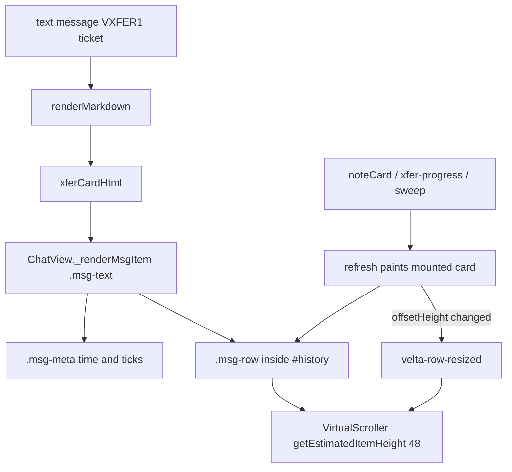
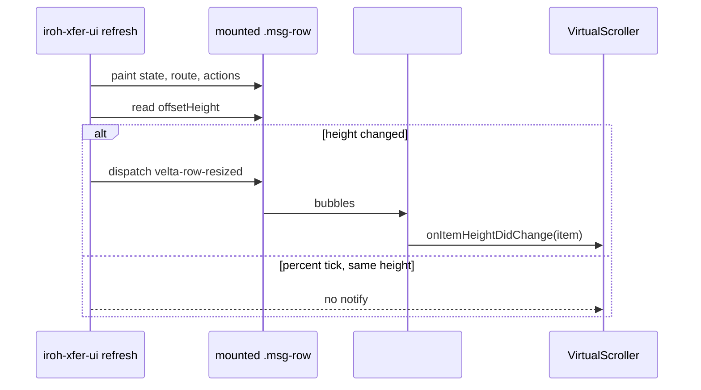

# Dash file cards in chat history

| | |
|---|---|
| Author | (unassigned) |
| Date | 2026-11-25 |
| Status | Draft |
| Tree read | web client at `af69c97f` |
| Surfaces | Web client only (Tauri desktop, Android WebView, PWA). Not KMP. |
| Design system | [velta.cc/design](https://velta.cc/design). The page is the contract; `app/css/main.css` is the source. Published snapshot `bc1f3e8f`, v1.5.1, 2026-11-03. |

## Overview

A Velta Dash transfer is a normal text message. The body is two readable lines plus a `VXFER1:` ticket (`fileCardText` in `app/js/iroh-xfer.js`). `renderMarkdown` (`app/js/markdown.js`) short-circuits that body to `xferCardHtml` (`app/js/iroh-xfer-ui.js`), and the result is painted inside `.msg-text` of an ordinary bubble by `ChatView._renderMsgItem` (`app/js/chat-view.js`). The bubble still carries `.msg-meta` (time and, on outgoing, ticks).

That card is a wrapping flex row. The filename is `word-break: break-all` with `flex: 1; min-width: 0`, so its min-content width collapses and the status, the Dash badge, and Open sit on the same line as a filename broken mid-token. The type mark is the first letter of the extension, which is why both `.mp4` bubbles in the screenshot show **M**. Size is a block inside the name. The row has no stable height, and `refresh()` updates the live DOM without telling the virtual scroller.

The proposal keeps the message a text bubble and the route badge. It replaces the flex row with a two-row grid: a 44px type tile, a single-line filename that keeps its extension, and a size line for the byte count, the Dash chip, and Open, Retry, or Ask. The status sentence leaves that line and shares the timestamp row with `.msg-meta`. Incoming steady copy becomes `Received with Velta Dash`, parallel to `Sent with Velta Dash` (`routeLabel("iroh")`). Today that string is `Received`. Open becomes a text button. The file still opens through `fileUrl`, not through an `href` and not through `open_document`. Time and ticks stay in `.msg-meta`, on that shared row, not inside the icon grid. An error sentence uses the same row and may wrap. The icon grid does not include that row, so the tile stays aligned with the other cards. State changes that do not change height must not call `onItemHeightDidChange`. No new hex.

## Background & Motivation

### What the screenshot is

The attached dark-theme capture (two bubbles, 01:24 outgoing and 01:30 incoming) is the **web client**, not Compose.

Evidence in the running markup, not in a theme guess:

- The tile letter is produced only by `xferCardHtml`: `(card.name.split(".").pop()?.[0] || "f").toUpperCase()`. Both files end in `.mp4`, so both tiles are **M**. It is not a video icon and not the first letter of the filename.
- Outgoing status text is `routeLabel("iroh")` → `Sent with Velta Dash`, followed by `.xfer-route[data-route="dash"]` (`P.dash` plus the word Dash). That is the “Sent with Velta Dash → Dash” line.
- Incoming “Received”, the same Dash badge, and the word Open are `.xfer-state`, `.xfer-route`, and `<a class="xfer-open">`.
- The clock and the double check are `.msg-meta` (`timeTag` + `ticksSvg`), floated to the bottom-right of `.msg-text`. They are not part of the card.
- Bubble fills match `:root` in `app/css/main.css`: outgoing `--bg-bubble-out: #2b5278`, incoming `--bg-bubble-in: #1c1c26`, tile `--accent: #5aa2e6`.

The same HTML/CSS is what Tauri desktop, the Android WebView shell, and the PWA paint. There is one card implementation. KMP does not share it (see Non-Goals).

The two names in the capture, reconstructed from the wrap points:

- `1795559063928-Untitled video - Made with Clipchamp.mp4` (7.2 MB, outgoing, sent)
- `1795559326328-Replay_2026.02.09-03.05.mp4` (166.3 MB, incoming, received, Open)

`fmtSize` in `iroh-xfer-ui.js` is `(n / 1048576).toFixed(1) + " MB"` above 1 MiB. 7.2 MB and 166.3 MB are that formatter, not a separate label.

### Why it reads as a text bubble

`xferCardHtml` returns one inline-turned-flex span:

```html
<span class="xfer-card" data-xfer="…">
  <span class="xfer-glyph">M</span>
  <span class="xfer-name">…name…<span class="xfer-meta">7.2 MB</span></span>
  <span class="xfer-state" role="status">Sent with Velta Dash</span>
  <span class="xfer-route" data-route="dash">…Dash</span>
  <!-- incoming, once a path exists: -->
  <a class="xfer-open" target="_blank">Open</a>
</span>
```

`app/css/main.css` lays it out as:

```css
.xfer-card { display: flex; flex-wrap: wrap; align-items: center; gap: 10px; padding: 4px 0; }
.xfer-glyph { width: 30px; height: 30px; … border-radius: 8px; }
.xfer-name { flex: 1; min-width: 0; font-weight: 600; word-break: break-all; }
.xfer-meta { display: block; … font-size: var(--fs-2); }
.xfer-state { … font-size: var(--fs-2); max-width: 22em; }
```

`flex: 1` is `1 1 0%`. With `word-break: break-all`, the name’s min-content width is about one character, so the flex line keeps the status and the badge beside the name and the name breaks wherever the leftover width runs out. That is the mid-token wrap in the screenshot (`vide` / `o`, `mp` / `4`, `2026.02.0` / `9-03.05.mp4`). `.xfer-meta { display: block }` then paints the size under that broken name, and `align-items: center` vertically centers the 30px tile against the whole block, which is why the size sits low and left.

`.bubble` sets `overflow-wrap: anywhere` (inherited) and `.msg-text` sets `white-space: pre-wrap` and `hyphens: auto` (inherited). The card never overrides them. The bubble’s own max width is `min(480px, 90%)` (`.bubble`), so a long unwrapped status (`max-width: 22em` on `.xfer-state`) stretches the bubble toward that cap. The card never becomes a file-shaped object with its own width.

`--fs-2` is not defined in `app/css/main.css`. It exists only in the webxdc token sheets (`app/webxdc/*/velta-tokens.css`, 13px). On the chat page `font-size: var(--fs-2)` is an invalid declaration, so status, size, and the route badge inherit `.msg-text`’s `--msg-font-size` (15.5px). The status is the same size as the filename. `.file-size` on a real file bubble is 12.5px. The Dash card does not use that.

### What already works and must stay

- **Wire format.** `fileCardText` / `parseFileCard` / `VXFER1:` / `VXFER-RESEND:`. Delta Chat and any client without the card still see the two readable lines. Core has no RPC to attach bytes to an existing message; received files land in `accounts/xfer-in/`, sealed, and the media server decrypts them (`docs/agents/p2p.md`, Dash section). The bubble stays `viewtype: text`.
- **States and copy.** `stateText`, `routeOf` / `routeBadgeHtml`, `canRetry`, `canAsk`, `actionsHtml`. Tests in `tests/iroh-xfer.test.mjs` lock the strings (`Sent with Velta Dash`, `Received`, `Waiting for sender…`, `Fetching via Velta Dash 34%`, `Asked for the email copy`, `Email fallback`, `Not enough free space`, the too-large and interrupted lines) and the hooks `xfer-route`, `data-route`, `xfer-open`, `xfer-ask`, `xfer-retry`, `xfer-state`, `is-busy`.
- **Open's destination.** Today the control is `<a class="xfer-open" href={fileUrl(path)} target="_blank" rel="noopener">`, which is what the screenshot shows. The row click handler in `_renderMsgItem` (`a[href]` branch) sends `http(s)` hrefs through `openHttp` (desktop: `plugin:opener|open_url`; Android: in-app browser) and leaves every other scheme to the browser default. `window.open` is not that desktop path: wry swallows it, and `openHttp` falls through to it only when the opener plugin throws. Selection mode returns before the link branch and does not `stopPropagation` or `preventDefault`, so the anchor can still navigate while messages are being selected. Do not retarget this at `openAttachmentFile` / `open_document`. That path is for core blobs. A Dash file is not a core blob; sending the sealed `accounts/xfer-in/` path to `open_document` can hand the OS ciphertext. The element changes (Status, route, actions). The destination does not.
- **Fetch and fallback.** `noteCard` → `startFetch`, progress via `xfer-progress` throttled to 250ms in `xferProgressEvent`, email ask, retry delays `RETRY_DELAYS_MS`. `refresh()` patches the mounted card in place so a progress tick does not rebuild the row (`_rowSignature` does not include card state, and the ticket text does not change).
- **Contrast.** `tests/bubble-label-contrast.test.mjs` locks `.xfer-meta` / `.xfer-state` / `.xfer-route` to `--text-dim` on incoming and `--text-meta-out` on outgoing, and `.xfer-glyph` to `--on-accent` on `--accent`, at 4.5:1, including custom accents and the brutal outgoing ink for `.xfer-name`. The incoming lock is the canvas secondary pair, not the published in-bubble pair. This pass moves incoming size, status, the Dash chip, and the busy ring (it is `currentColor`) to `--text-meta-in`, and adds Open pairs. The glyph pair and the brutal outgoing name stay.
- **Bubble chrome.** Tail radii, padding `7px 10px 6px`, outgoing alignment (`.msg-row.out { justify-content: flex-end }`), reply pill, reactions, quote, forward label, context menu, coarse-pointer `user-select: none` until Select text. Thead replies call the same `_renderMsgItem` (`inThread: true`) but are not virtualized.

### Scroller constraint

History is `#history` inside `#history-scroll`, built by `ChatView._createScroller`. The list is `app/vendor/virtual-scroller.js` (Velta’s `__vsZoom` patch). `.history-scroll` sets `overflow-anchor: none` because the scroller positions rows with padding and the browser’s anchor fights it. A height change above the viewport therefore moves the visible rows by the same number of pixels. Rows must not get `content-visibility`: the scroller measures mounted rows itself, and a collapsed placeholder desyncs the height cache (`AGENTS.md`). Media boxes are width-first (#27): no percentage inside `min()` on the shrink-to-fit bubble. A video with no dimensions is the 260px `.msg-video` band.

`getEstimatedItemHeight` is 48px. `onItemHeightDidChange` is wired in `_createScroller` to the bubbling `velta-row-resized` event, and `onMsgUpdated` notifies only **after** `replaceWith`. A burst of notifies re-lays out the window; later rows are then measured against a stale cache. `refresh()` today never fires `velta-row-resized`. Card-internal wraps (Open appearing, a status string going from one line to two, a percent string changing wrap) desync the spacer until something else remeasures the row.

Opening a chat re-pins with `_settleScroll` (40ms interval, stop at 4 stable frames or 90 ticks, then a 450ms reassert) so the first measure can settle. `wheel` and `touchstart` cancel that pin. A height change mid-scroll is not absorbed.

Unmounted rows are kept in `_rowCache` and reused when the signature matches. `refresh()` uses `document.querySelectorAll`, so a card that finishes fetching while scrolled off screen keeps the DOM it had when it was detached. Remount shows the stale status until another `refresh()` happens to run while it is connected. Card state is not in `_rowSignature`, so a text-identical ticket does not rebuild the row. That is existing behavior; the redesign must not make it worse, and the implementation should close it.

## Goals & Non-Goals

### Goals

- A Dash message reads as a file card: type tile, one-line filename, size, transfer status, route, action, then the existing time/ticks.
- No mid-token wrap of the filename. The extension stays visible when there is one.
- The type affordance is an outline icon from `app/js/icons.js`, not a letter. `.mp4` uses `P.video`.
- Incoming and outgoing share the grid. Color differences are published token pairs. Incoming meta moves from `--text-dim` to `--text-meta-in`. The contrast test is updated in the same change. No new hex.
- Steady states do not change row height: sent, receiving, percent ticks, received plus Open, and a one-line Retry or Ask on a desktop-width card. A second action line on a narrow bubble may. An error sentence adds one line, and one notify, only while `.is-error` is on.
- Open, Retry, and Ask still do those jobs. Open is a button. Retry and Ask stay buttons. The busy ring and `role="status"` stay on `.xfer-state`. There is no button loading state.
- `refresh()` tells the scroller only when `offsetHeight` actually changed, and a recycled row is repainted before the scroller measures it.
- The composer’s file thumb stops using the letter, via the same kind helper, without changing the 96×64 thumb box.

### Non-Goals

- KMP. `FileCard` in `velta-kmp/composeApp/src/commonMain/kotlin/org/velta/kmp/ui/App.kt` is the core `viewtype == "File"` card (44dp accent circle, `viewTypeIcon`, two-line ellipsis). `markdownAnnotated` (`Markdown.kt`) has no `VXFER1:` short-circuit, so a Dash offer on KMP still renders as plain text, ticket included. This design does not port Dash or hide that ticket.
- Changing `chooseRoute`, thresholds (6 MB / 22 MB), tickets, `xfer.rs`, or the email fallback.
- Turning a ticket that has no preview into a core file/video message, or giving that ticket a `<video>` / lightbox poster. A video row with no dimensions is the 260px `.msg-video` band, and that height is the jump the ticket card avoids. When history already paints `.msg-image` or `.msg-video`, that preview stays. See Image and video.
- A progress bar. Percent stays in the status string.
- Moving time, ticks, stars, bot/admin chips, or “edited” out of `.msg-meta`.
- Rewriting `.msg-file` (core attachments), `.msg-webxdc`, or `.msg-transfer` (Loop). They are the patterns to copy, not the thing being restyled.
- RTL. The shipped UI languages are LTR. Do isolate the extension so a bidirectional override in the basename cannot visually eat it (Security).
- Feature-flagging the layout. Rollback is reverting the commit.

## Proposed Design

### Design system

The card follows the published system at [velta.cc/design](https://velta.cc/design). Component states are at [velta.cc/design/components/](https://velta.cc/design/components/). The page is the contract. The source is `app/css/main.css`. The published snapshot is `bc1f3e8f`, v1.5.1, 2026-11-03. Regenerate with `node tools/gen-design-tokens.mjs`. This pass adds no hex and no `@font-face`. The card sets no `font-family`. Dark is primary. Light and brutal use the same rules. No pure black or white.

Tokens this card uses:

- **Bubble surfaces.** `--bg-bubble-in` / `--bg-bubble-out`. No nested `--bg-hover` fill. Hover on a `.btn-text` changes that control's surface (`background: var(--bg-hover)` inside the existing fine-pointer media query) and does not change its ink.
- **Type tile.** `--accent` fill, `--on-accent` ink, `border-radius: var(--radius-media)` (10px), svg at `var(--ico-4)`. Same pair as `.msg-file .file-ico`. It is a type affordance, not a status chip and not `.btn-primary` (one filled accent action per view, never in a list). Do not recolor it to `--green`, `--text-dim`, or `--text-meta-in`.
- **Filename.** Inherited `--text`, except brutal outgoing, where `.xfer-card` already sets `--nb-main-ink`. 14.5px / 600. Weight stays 600 so the name outranks the 12.5px meta line. `.file-name` is 500; that is a different card.
- **Meta line and timestamp.** Size, status, and the Dash chip: `--text-meta-in` on incoming (published 5.29 on the dark incoming bubble), `--text-meta-out` on outgoing (published 4.59 on the dark outgoing bubble, borderline AA, including brutal `#55480a`). `--text-dim` is secondary ink on the canvas (published 5.67 on `--bg` in dark), not the in-bubble pair, so the incoming card leaves it. Timestamps stay in `.msg-meta` at 11.5px on `--text-meta-in` / `--text-meta-out`. Unread (`--ticks-read`, `--on-badge`) and presence (`--green`) stay off this card.
- **Open.** A verb. Incoming keeps the existing `.btn-text` colors: `--accent-text` on dark, `--accent-text-in` on light, `--accent-2` on brutal incoming. Raw light `--accent` is UI/large only (published 3.01) and is not the label. Outgoing dark and light use `--out-link`. Brutal outgoing uses `--nb-main-ink`: brutal does not redefine `--out-link` (it inherits the dark value), and that light ink is not the published pair for the yellow outgoing bubble. `--text` is the filename, so it is not the verb either.
- **Focus.** The shared `button:focus-visible` rule in `main.css`: `outline: 2px solid var(--focus-ring); outline-offset: 2px`. Light `--focus-ring` is the darkened accent, not raw `--accent`. Do not add a second ring.
- **Type and space.** Filename 14.5px. Meta 12.5px, inside the 11–12.5 meta band. Body stays `--msg-font-size` (15.5px) on `.msg-text` and is not the card's status size (that was the undefined `--fs-2` bug). One system stack, from `body`. Spacing is the 2px grid. `row-gap` is 2px. A 1px row gap is off that grid and is not an amber exception. Column gap 10px, `.xfer-sub` gap 6px, and card padding `2px 0 0` stay. Bubble padding `7px 10px 6px` stays; it is a documented amber exception. `--radius-bubble` stays 14px in dark and light and 6px in brutal, and is not restated on the card.

Contracts this card uses:

- **Button, not link.** `.btn-text` is a button for an action that happens (Open, Retry, Ask). A link is navigation and is underlined. Open is not underlined and carries no `href`.
- **Chip.** `.xfer-route` is passive metadata, the same family as `.relay-flag` and `.day-chip`. A status token, never accent. Not focusable, no hover, no extra pill chrome (a border or a 999px radius would change the row).
- **Not an icon button.** Icon buttons are 40px and need an `aria-label`. Open, Retry, and Ask have visible labels. The ≥44px touch-target note is still under review (#182) and is not applied here. A 40px or 44px box, or `.btn-text`'s default `padding: 10px 14px` on top of `.msg-text`'s `line-height: 1.36`, is taller than the room under the filename inside the 44px tile. All three actions use the tight box below.
- **No button loading state.** Progress stays on the status surface: `.xfer-state.is-busy::before`. Not a spinner on Open, Retry, or Ask, and not a new transfer pill.

### Render path



`xferCardHtml` remains the only Dash renderer. `renderMarkdown` still returns on the first line that `parseFileCard` accepts, before emphasis, links, or hyphenation, so the ticket never becomes text nodes. The `VXFER-RESEND:` line stays a bare `.xfer-state` label, not a card.

### Target geometry

Desktop-width card (the screenshot’s case), content box max 320px, matching `.msg-audio`’s cap. The 44px tile matches `.msg-file .file-ico`. Radius is `--radius-media` (10px at the default bubble radius), not a circle, so it is not the 42px audio play disc.

```text
outgoing, no action
┌──────────────────────────────────────────────┐
│ [video]  1795559063928-Untitled vide….mp4    │
│          7.2 MB                         Dash │
│ Sent with Velta Dash                 01:24 ✓✓│
└──────────────────────────────────────────────┘

incoming, received
┌──────────────────────────────────────────────┐
│ [video]  1795559326328-Replay_202….mp4       │
│          166.3 MB                    Dash Open│
│ Received with Velta Dash                01:30│
└──────────────────────────────────────────────┘

The icon grid is only the name row and the size row. The status sentence and `.msg-meta` are a sibling row under the grid. A wrapping error grows that sibling. It does not restretch the tile.
```

Rough row height, steady state, default font:

| Piece | px |
|---|---|
| Bubble padding top + bottom | 7 + 6 |
| Tile | 44 |
| Two text rows inside the tile (14.5px name, 12.5px meta) | fits in 44 |
| `.msg-meta` margin-top 6 + 11.5px line, float below the block | ~20 |
| `.msg-row` padding | 4 |
| **Row** | **~80** |

Today’s wrapped screenshot cards are taller (three visual lines of 15.5px text plus the size block plus meta) and the height depends on the filename. After this change a sent card and a received card on a window wide enough for the meta line are the same height. The one-time remeasure when a chat opens is absorbed by `_settleScroll`. Do not animate the height.

Width, copied from the audio/file pattern that already survives outgoing shrink-to-fit (do not invent a `min(320px, 100%)` inline width; that is the #27 shrink-to-fit trap):

```css
.xfer-card {
  display: grid;
  grid-template-columns: 44px minmax(0, 1fr);
  grid-template-areas: "glyph name" "glyph sub";
  column-gap: 10px;
  row-gap: 2px; /* 2px grid. 1px is not an amber exception. */
  align-items: center;
  width: 100%;
  max-width: 320px;
  min-width: min(240px, var(--bubble-inner-max));
  box-sizing: border-box;
  padding: 2px 0 0;
  white-space: normal;
  overflow-wrap: normal;
  word-break: normal;
  -webkit-hyphens: manual;
  hyphens: manual;
}
```

`--bubble-inner-max` is `calc(var(--vw) - 120px)`, the existing cap so a 320px phone does not get a 240px min-width it cannot hold (comment on that token in `main.css`). `minmax(0, 1fr)` is what stops the filename from setting the card’s min-content. `white-space: normal` beats the inherited `pre-wrap`. `overflow-wrap: normal` and `word-break: normal` beat the bubble’s `anywhere` and today’s `break-all`. `hyphens: manual` beats `.msg-text`.

No inner surface. `.msg-webxdc` paints `--bg-hover` because it sits in a bubble as an app card with its own padding; nesting that inside a Dash bubble adds a height step and fights the brutal bubble shadow. The bubble is the card. Brutal outgoing already sets `.xfer-card { color: var(--nb-main-ink) }`; keep it.

### Markup

`xferCardHtml` grows a structure `refresh()` can still find. Classes and `data-*` hooks stay. Strings stay. No whitespace between the two name spans, or copy/selection inserts a gap and the spoken name breaks.

```html
<span class="xfer-card" data-xfer="HASH">
  <span class="xfer-glyph" aria-hidden="true"><svg><!-- P.video for .mp4 --></svg></span>
  <span class="xfer-name" title="1795559063928-Untitled video - Made with Clipchamp.mp4">
    <span class="xfer-name-base">1795559063928-Untitled video - Made with Clipchamp</span><span class="xfer-name-ext">.mp4</span>
  </span>
  <span class="xfer-sub">
    <span class="xfer-meta">7.2 MB</span>
    <span class="xfer-route" data-route="dash"><svg></svg><span>Dash</span></span>
    <!-- actionsHtml(), only when non-empty, last in .xfer-sub.
         Open is a button, not an anchor:
         <button type="button" class="xfer-open btn-text" data-xfer-open="HASH">Open</button> -->
  </span>
</span>
<span class="xfer-foot">
  <span class="xfer-state" role="status">Sent with Velta Dash</span>
  <!-- existing .msg-meta (time, ticks, stars, edited) moves here for this card only -->
</span>
```

```css
.xfer-card .xfer-glyph {
  grid-area: glyph;
  width: 44px; height: 44px; border-radius: var(--radius-media);
  /* background/color unchanged: --accent / --on-accent */
}
.xfer-card .xfer-glyph svg { width: var(--ico-4); height: var(--ico-4); }
.xfer-name {
  grid-area: name;
  display: flex; min-width: 0;
  font-size: 14.5px; font-weight: 600; line-height: 1.25;
}
.xfer-name-base {
  flex: 0 1 auto; min-width: 0;
  overflow: hidden; text-overflow: ellipsis; white-space: nowrap;
  unicode-bidi: isolate;
}
.xfer-name-ext { flex: none; white-space: nowrap; unicode-bidi: isolate; }
.xfer-sub {
  grid-area: sub;
  display: flex; align-items: center; gap: 6px;
  min-width: 0; flex-wrap: nowrap;
}
.xfer-meta { display: inline; flex: none; font-size: 12.5px; font-weight: 400; }
.xfer-state {
  flex: 1 1 auto; min-width: 0;
  overflow: hidden; text-overflow: ellipsis; white-space: nowrap;
  font-size: 12.5px; max-width: none;
}
.xfer-route { flex: none; font-size: 12.5px; font-weight: 600; }
.xfer-open, .xfer-ask, .xfer-retry { flex: none; white-space: nowrap; }
/* Beat the base color: --text-dim (0,1,0). Outgoing rule already exists. */
.msg-row:not(.out) .xfer-meta,
.msg-row:not(.out) .xfer-state,
.msg-row:not(.out) .xfer-route { color: var(--text-meta-in); }
.msg-row.out .xfer-meta,
.msg-row.out .xfer-state,
.msg-row.out .xfer-route { color: var(--text-meta-out); }
/* Default .btn-text is padding 10px 14px. button { font: inherit } plus
   .msg-text { line-height: 1.36 } makes that control about 41px tall.
   Name row + row-gap 2px + 41px is about 61px, past the tile, on one line.
   14px / line-height 1 / 4px 8px is about 22px.
   14.5 * 1.25 + row-gap 2 + 22 is about 42, inside the 44px tile.
   Open, Retry, and Ask share the box. Colors stay separate. */
.xfer-open.btn-text,
.xfer-ask.btn-text,
.xfer-retry.btn-text {
  font-size: 14px; font-weight: 600; line-height: 1;
  padding: 4px 8px; text-decoration: none;
}
/* Beat .msg-row.out .btn-text (0,2,0), which would paint Open as status meta. */
.msg-row.out .xfer-open.btn-text { color: var(--out-link); }
html[data-theme="brutal"] .msg-row.out .xfer-open.btn-text { color: var(--nb-main-ink); }
```

12.5px is the meta size, not `var(--fs-2)` and not `.file-size`'s incoming `--text-dim`. Name metrics match `.msg-file .file-name` (14.5px / 500 there, 600 here so the filename still wins over the meta line; do not drop the weight or the card goes flat against 12.5px meta). The chip stays weight 600. Color, not weight, separates it from Open.

Incoming Open has no color rule of its own. It uses `.btn-text`, then the light incoming `--accent-text-in` rule and the brutal incoming `--accent-2` rule. Those rules also cover Retry and Ask, and they stay that way. Focus is the shared `button:focus-visible` ring. Hover is the shared `.btn-text` surface. The hover rule changes the background only.

`.xfer-meta { display: block }` is removed. Size is the first item of `.xfer-sub`.

The glyph rule without `.xfer-card` stays at 30px. The composer thumb (`#media-preview-thumb`, 96×64) reuses the class and must not jump to 44px.

### Filename split

Pure helper next to `parseFileCard` in `app/js/iroh-xfer.js`, so `tests/iroh-xfer.test.mjs` can lock it without a DOM:

```js
const MULTI_EXT = [".tar.gz", ".tar.bz2"];
const EXT_RE = /\.([A-Za-z0-9]{1,8})$/;
export function splitFileName(name) {
  const n = String(name || "");
  const lower = n.toLowerCase();
  for (const ext of MULTI_EXT) {
    if (lower.endsWith(ext) && n.length > ext.length) {
      return { base: n.slice(0, -ext.length), ext: n.slice(-ext.length) };
    }
  }
  const m = EXT_RE.exec(n);
  if (!m || m.index === 0) return { base: n || "file", ext: "" };
  return { base: n.slice(0, m.index), ext: m[0] };
}
```

The allow-list is those two suffixes, matched case-insensitively, and the returned extension keeps the filename's own characters. `foo.tar.gz` and `foo.tar.bz2` keep `.tar.gz` and `.tar.bz2` as one extension. Last-suffix remains the default for everything else. `Replay_2026.02.09-03.05.mp4` keeps `.mp4`. A bare `.gz` keeps `.gz`. A leading-dot name (`.mp4`) is all base. No extension means end-ellipsis of the whole string. `fileKind` still reads the last suffix: `gz` is already `archive`, and `bz2` joins that set so `.tar.bz2` uses `P.archive`.

`flex: 0 1 auto` on the base: when the column is wider than the name, the base stays content-sized and there is no gap before the extension; when the column is narrower, the base shrinks and ellipsizes, and the extension does not. Both spans hold the real characters, so Select text and clipboard copy the full name. `title` is the full name for pointer hover. Do not also set `aria-label` to that string; the text content is already the name, and a label would double it.

This is truncation, not wrapping. There is no second filename line, so a short name and a long name occupy the same grid row.

### Type icon

```js
const VIDEO = new Set(["mp4", "m4v", "mov", "webm", "mkv", "avi"]);
const AUDIO = new Set(["mp3", "m4a", "aac", "ogg", "opus", "wav", "flac"]);
const IMAGE = new Set(["jpg", "jpeg", "png", "gif", "webp", "heic", "avif"]);
const ARCHIVE = new Set(["zip", "7z", "rar", "tar", "gz", "tgz", "bz2"]);
export function fileKind(name) {
  const ext = (EXT_RE.exec(String(name || ""))?.[1] || "").toLowerCase();
  if (VIDEO.has(ext)) return "video";
  if (AUDIO.has(ext)) return "audio";
  if (IMAGE.has(ext)) return "image";
  if (ARCHIVE.has(ext)) return "archive";
  return "file";
}
```

`iroh-xfer-ui.js` maps the kind through the existing icons, all 24px outline, `currentColor`, already decorative (`aria-hidden`):

| kind | icon | why |
|---|---|---|
| video | `P.video` | frame + play triangle. The screenshot files. |
| audio | `P.mic` | same stand-in KMP `viewTypeIcon` uses for Audio. No separate audio-file glyph. |
| image | `P.photo` | |
| archive | `P.archive` | |
| file | `P.file` | pdf, doc, unknown, no extension. Do not invent a PDF glyph. |

No letter fallback. The composer path in `ChatView._renderMediaPreview` (`pm.kind === "file"`) currently does the same `split(".").pop()[0]` into a `.xfer-glyph`. It calls `fileKind` and appends the same SVG, still inside the 30px glyph the thumb already centers. Video attachments on the strip already use `_composerVideoCard`; this only replaces the generic-file letter.

The tile stays decorative. The extension in the name is the text alternative. Do not add a visually hidden “Video” that the status line would also be saying.

### Status, route, actions

`.xfer-sub` order is fixed: size, `.xfer-state`, `.xfer-route`, then actions. `routeBadgeHtml`'s structure is unchanged (Dash arrow or `P.mail`, label Dash or Email fallback, `data-route` `dash` or `email`, icon `currentColor`). Its color is not. `.xfer-route` is a passive status chip. Incoming `--text-meta-in`, outgoing `--text-meta-out`, in dark, light, and brutal. Never `--accent`, `--green`, or `--ticks-read`. It is not a control: no button, no hover, no border, no pill. The chat-header `.dash-badge` is a different control and is not restyled here.

`role="status"` stays on `.xfer-state` only. Putting it on `.xfer-card` or `.xfer-sub` would re-announce the filename on every percent tick. The 250ms throttle in `xferProgressEvent` stays. The busy ring stays `.xfer-state.is-busy::before` (inline, `currentColor`, 2.4s under `prefers-reduced-motion`). It occupies a few pixels at the start of the status and must not add a row.

On a 320px card at 12.5px the screenshot strings fit on the meta line without ellipsis:

- `7.2 MB` + `Sent with Velta Dash` + Dash badge ≈ 250px of the ~266px column (320 − 44 − 10).
- `166.3 MB` + `Received` + Dash badge + Open fits the same way.

Below that, a non-error `.xfer-state` is the only item allowed to ellipsize (`min-width: 0`). Size, badge, and buttons are `flex: none`. The full status string remains the text content, so the contrast test, the iroh tests, and `role="status"` still see `Sent with Velta Dash` and not a shortened substitute. Hover can use `title` on a visually cut non-error `.xfer-state` set to the same string; do not shorten the DOM text to make the tests pass.

Actions stay `actionsHtml`. Open changes element. Retry and Ask do not change color.

Open is an action, not navigation. The control is:

```html
<button type="button" class="xfer-open btn-text" data-xfer-open="HASH">Open</button>
```

No `href`, no `target`, no underline, no `aria-label` (the visible word is the name). The class `xfer-open` stays so `tests/iroh-xfer.test.mjs` (`/xfer-open/`) still matches. PR 1 adds an assertion that this node is a `button` with `data-xfer-open` and without `href`.

Rejected: keeping `<a class="xfer-open">` as an exception. The published contract calls an anchor a link, and a link is navigation and is underlined. `fileUrl` does not require an `href` in the bubble. The row's `a[href]` branch is how today's anchor happens to open; it is not a reason to mark the control as navigation. Stripping the underline would not make it a button.

`.msg-row.out .btn-text` sets `--text-meta-out` because raw accent fails AA on the outgoing bubble (the comment on that rule: 3.0 dark, 2.85 light, 1.67 brutal). That token is correct for Retry and Ask. It would paint Open in the status color. Open overrides only itself:

- Outgoing, dark and light: `--out-link` (specificity `.msg-row.out .xfer-open.btn-text`, 0,3,0, beats 0,2,0). Not `--text`. The filename is already `--text`, and `--out-link` is the published outgoing-link ink.
- Outgoing, brutal: `--nb-main-ink`. Brutal inherits dark `--out-link` and does not publish that ink on `--nb-main`. `--text` fails on that yellow for the same reason the name does not use it. The name's locked pair is `--nb-main-ink`.
- Incoming: no Open-only color. Dark `--accent-text`, light `--accent-text-in`, brutal incoming `--accent-2`. Never raw light `--accent`.

Retry and Ask keep `btn-text` and those three existing color rules, including outgoing `--text-meta-out`. They share Open's box (`14px`, line-height 1, padding `4px 8px`). They do not share Open's color override.

The button does not carry the media URL. `actionsHtml` stores the hash, the same way Retry and Ask do. The document `click` listener in `initXferUi` (the one that already handles `data-xfer-retry` and `data-xfer-ask`, bubble phase, after the row listener) gains `data-xfer-open`:

1. If the button's row has `.selectable`, return. The row listener already toggled selection and returned without `stopPropagation`. Do not also open.
2. A reply swipe no longer starts on Open. `GESTURE_SKIP_SELECTOR` is `"button, input, textarea, audio"`. The comment above it leaves links out on purpose (`#35`) so a swipe may start on an anchor. Today's `<a class="xfer-open">` is such an anchor. A `<button class="xfer-open btn-text">` matches the skip list, which Retry and Ask already do. The 400ms guard is only for a swipe that started elsewhere on the bubble (the filename, the tile) and whose synthesised click lands on Open. That guard lives in `ev.click` inside `_renderMsgItem`. `routeRowEvent` / `wireRowDelegation` find the row and call `row._rowEvents.click`. It is not `_renderItem`. The same 400ms window is already checked there for the hashtag button, the code-copy button, and the vcard button. When the target is `[data-xfer-open]` and `_swipedAt` is inside the window, `stopPropagation` and return, so the document listener does not see the click. Do not add a second timer in `iroh-xfer-ui.js`.
3. Read `cardState` for the hash and call `safeFileUrl(st.path)` then. A missing path does nothing.
4. `http:` and `https:` (the loopback media server, `http://blobfile.localhost`, wasm blob hrefs, `convertFileSrc` when it is `http(s)`) go through `openHttp`. `ensureXfer` already calls `initXferUi` and closes over `openHttp`. Add `openHttp` on that object. Today the call does not pass `listen`; the glue may keep falling back to `window.__TAURI__?.event?.listen`. Do not hang the hook on `_renderItem`, and do not import `chat-view.js` from `iroh-xfer-ui.js`. `stripTrackingUrl` stays inside `openHttp`; on a `127.0.0.1` media URL it does not change the token.
5. Any other scheme (`blobfile:`) uses `window.open(url, "_blank", "noopener")`, standing in for the browser default the anchor used. Do not send those schemes through `openHttp`. Do not call `openAttachmentFile` or `open_document`.

`openHttp` on desktop is `plugin:opener|open_url`. `window.open` is only the non-http branch and the plugin's existing catch. Open, Retry, and Ask share `4px 8px` at 14px / line-height 1 / weight 600, so each box is about 22px and a one-line action stays inside the 44px tile. Default `.btn-text` padding is forbidden on all three. Left on Retry or Ask, `padding: 10px 14px` plus the inherited 1.36 line-height is about 41px, and the text stack is about 61px, so inserting the button changes `offsetHeight` even when the label fits. On the 320px card the text column is about `320 − 44 − 10 = 266px`. `Ask for the email copy` is on the order of 200px at this size, so the wrap predicate below does not fire, and the padding would still grow the card. No `min-height: 32px`, no 40px icon-button box, no 44px hit target. Coarse pointers do not get a taller action. There is no loading state on the button. Percent and the busy ring stay on `.xfer-state`.

`refresh()` must stop appending actions with `insertAdjacentHTML("beforeend")` on the card. That dumps Open after `.xfer-sub` and the grid would not place it. Append into `.xfer-sub`, replacing previous `.xfer-ask, .xfer-retry, .xfer-open` as it does now.

`.xfer-sub` stays `flex-wrap: nowrap` unless the action's own box is wider than the column. Inserting Open, Retry, or Ask on one line does not change card height, because they share the 22px box. The wrap predicate is only about a second line: after paint, if `scrollWidth > clientWidth` **and** an action's `flex: none` box alone exceeds the column, set `flex-wrap: wrap` for that paint and let the action drop to a second line with `margin-left: auto`. That second line is a real height change. It is the narrow-bubble case (the label wider than the column), not the 320px screenshot, and not a percent tick. `Ask for the email copy` on the 320px card does not meet the predicate. Do not treat "predicate true" as the notify. `refresh()` applies the wrap in the same turn, then reads `offsetHeight`, and notifies only when that integer changed. Do not pre-reserve the second line on every card.

Error copy is fully visible. When `stateText` returns an `ERRORS` string (`too-big`, `too-big-recv`, `interrupted`, `no-space`, `too-large`, `missing`), `.xfer-state` gains `is-error`. The sentence stays in `.xfer-foot`, beside `.msg-meta`, and wraps there. It is not inside `.xfer-sub` and not inside the icon grid. Size, the chip, and Retry stay on the size row. Steady states (sent, receiving, a percent tick, received) are one foot line and do not reserve a wrap. Asked-for-email is a foot sentence, not an error wrap, unless its own text exceeds the row.

```css
.xfer-foot {
  display: flex; align-items: flex-start; justify-content: space-between;
  gap: 10px; margin-top: 2px;
}
.xfer-foot .xfer-state { flex: 1 1 auto; min-width: 0; font-size: 11.5px; line-height: 1.3; }
.xfer-foot .msg-meta { float: none; margin: 0; flex: none; }
.xfer-state.is-error { white-space: normal; }
```

The foot is outside the grid, so `align-items: center` on `.xfer-card` keeps the 44px tile in the same place on a sent card and on an error card. Putting the sentence inside `.xfer-sub` centered the tile in the taller block. That is the misalignment to avoid. A wrap of `.is-error` changes `offsetHeight` once. That is the one scroller notify. A later paint that keeps the class does not notify again.

### Timestamp, incoming, outgoing

`.msg-meta` stays the time, ticks, stars, edited, bot, admin, and reply count. For a Dash card it stops floating and sits in `.xfer-foot`, right side, 11.5px, `--text-meta-in` / `--text-meta-out`. The status sentence is the left side of that same row, same size and the same meta ink. Do not pull the time into the icon grid. Other message types keep the float.

Incoming vs outgoing is still `.msg-row` / `.msg-row.out`:

- Alignment and bubble fill, tail corner, unchanged.
- Meta ink: incoming `.xfer-meta`, `.xfer-state`, and `.xfer-route` are `--text-meta-in`. Outgoing stays `--text-meta-out`. The chip is in that list. Open uses the verb colors in the previous section.
- The grid and the tile are the same on both sides. Filename color is inherited `--text`, and brutal outgoing name ink stays `--nb-main-ink` via the existing `.xfer-card` color rule. The chip does not inherit that name ink. Its own `--text-meta-out` rule wins.

Quote, forward label, and reactions stay outside the card, in the order `_renderMsgItem` already builds. A quote above the card does not change the grid. The card’s `max-width: 320px` still applies; the bubble may be wider because of the quote, and the card does not stretch to 480px.

### Scroller contract



`refresh()` after painting:

1. Apply the wrap mutation in this same turn, before measuring, when the predicate in the previous section matches.
2. Read `card.offsetHeight` (the card, not the row; the row includes meta, which this paint does not change).
3. Compare to `card.dataset.xferH` stored as an integer pixel string.
4. On the first paint, store the height and do not notify. The scroller measures the row when `renderItem` returns.
5. On a later paint, notify only when the integer height differs. The wrap predicate does not dispatch by itself. A predicate hit that leaves the integer unchanged does not notify. A height change that is not a wrap still does. Dispatch `velta-row-resized` with `bubbles: true` from the card. The listener in `_createScroller` already does `closest(".msg-row")` and `onItemHeightDidChange`. Do not import the scroller into `iroh-xfer-ui.js`, and do not call `onItemHeightDidChange` from a progress tick that did not change height. A 250ms notify storm is a scroll jump under `overflow-anchor: none`.
6. Ignore a disconnected card (no `offsetHeight` worth comparing). The recycle path covers it.

Cache hit in `_renderItem`, before `return cached`:

```js
paintXferIn(cached); // new export: paint every [data-xfer] under this node, mounted or not
```

`paintXferIn` must not depend on `document.querySelectorAll`. It paints the element it was given, so a detached cached row updates before the scroller measures the mount. That measurement sees the final height, so this path also does not notify. Thread-sheet rows are appended directly and are connected; `refresh()`’s document query still updates them, and a height change there just grows the sheet (no virtual spacer).

`CSS.escape` is unnecessary: `data-xfer` is the ticket hash, `[0-9a-f]{64}`.

Do not change `overflow-anchor`, the 48px estimate, `__vsZoom`, or `_settleScroll`. Do not set `content-visibility` on the row. The bubble comment already forbids it: a collapsed placeholder desyncs the height cache.

### What “done” looks like on the screenshot

On the dark theme, at a desktop history width (`#history` max-width 728px, bubble cap 480px):

- Both names are one line. `.mp4` is visible. Nothing breaks between `vide` and `o`, or between `mp` and `4`.
- Both tiles are `P.video` in a 44px accent rounded square, not the letter M.
- Size, status, and the Dash badge share the second row. The badge is meta ink, not accent. Open, when present, is a text button at the end of that row, not a word glued to the badge and not an underlined link.
- 01:24 with the double check, and 01:30, stay bottom-right of the bubble.
- Replacing the status from `Fetching via Velta Dash 9%` to `Fetching via Velta Dash 34%` to `Received` and inserting Open does not change `offsetHeight` on that width, and does not call `onItemHeightDidChange`.

### Image and video

Two states. A Dash message with no preview is the file row above: 44px type tile, one-line name, size row, timestamp row. A Dash message that already shows a picture or a video poster keeps that preview and uses the same caption rows under it. The preview replaces the tile. It does not sit beside a 44px icon.

```text
incoming image
┌──────────────────────────────────────────────┐
│ [photo, radius-media, the open control]      │
│ 1795562108894-unknown_….png                  │
│ 6.8 MB   Dash                 Show in folder │
│ Received with Velta Dash                02:15│
└──────────────────────────────────────────────┘

outgoing video
┌──────────────────────────────────────────────┐
│ [poster + .velta-video-play]                 │
│ 1795566026819-Untitled video ….mp4           │
│ 7.2 MB   Dash                 Show in folder │
│ Sent with Velta Dash                 03:20 ✓✓│
└──────────────────────────────────────────────┘
```

- The name is one line and keeps the extension, same `splitFileName` rule. A generated name does not get its own stack of rows.
- The size row is the byte count, the Dash chip, and `Show in folder`. No `Open image` pill. No `Play video` pill. The picture is the open control for an image. `.velta-video-play` (54px disc, `pointer-events: none`, taps fall through to the existing lightbox route) is the open control for a video.
- `Show in folder` is `<button type="button" class="btn-text">`. It is a button because it does something. It does not look like a filled or outlined button. No fill, no border, no pill. Weight 600, 14px, padding `4px 8px`, so it reads as a verb next to the 12.5px size. Incoming uses the `.btn-text` verb colors. Outgoing dark and light use `--out-link`, because `.msg-row.out .btn-text` would paint `--text-meta-out` and the control would disappear into the size line. Brutal outgoing uses `--nb-main-ink`. A history is a list, so this is not `.btn-primary`.
- The status sentence shares `.xfer-foot` with `.msg-meta`, same as the file row. `Received with Velta Dash` on an incoming image. `Sent with Velta Dash` on an outgoing video. The chip stays on the size row.
- Media geometry stays the existing rules in `app/css/main.css`: `.msg-image .img-wrap`, `.msg-video`, `.velta-video-play`. This pass does not invent a new poster size. The caption does not change the media box, so a percent tick still must not change row height.
- Static previews: `docs/dash-history-file-card-preview.html` (no media) and `docs/media-card-preview.html` (image and video).

## API / Interface Changes

No JSON-RPC, no Tauri command, no ticket field.

| Symbol | Module | Change |
|---|---|---|
| `splitFileName(name) → {base, ext}` | `app/js/iroh-xfer.js` | New. Pure. |
| `fileKind(name) → "video"\|"audio"\|"image"\|"archive"\|"file"` | `app/js/iroh-xfer.js` | New. Pure. |
| `xferCardHtml` | `app/js/iroh-xfer-ui.js` | New DOM shape above. Same classes the tests match, plus `xfer-name-base`, `xfer-name-ext`, `xfer-sub`. |
| `actionsHtml` | `app/js/iroh-xfer-ui.js` | Open is `<button type="button" class="xfer-open btn-text" data-xfer-open>`. No `href`. Retry and Ask stay buttons and share the 14px box. Colors unchanged. |
| `initXferUi` | `app/js/iroh-xfer-ui.js` | Document click handles `data-xfer-open`. New `openHttp` hook. |
| `refresh` | `app/js/iroh-xfer-ui.js` | Paints into `.xfer-sub`. Wraps, then notifies only when integer `offsetHeight` changed. |
| `paintXferIn(root)` | `app/js/iroh-xfer-ui.js` | New. Used by the history cache hit. |
| `ChatView._renderMediaPreview` | `app/js/chat-view.js` | File thumb uses `fileKind` + SVG instead of a letter. |
| `ChatView._renderItem` | `app/js/chat-view.js` | Cache hit calls `paintXferIn` before `return cached`. Nothing else. |
| `ChatView._renderMsgItem` | `app/js/chat-view.js` | `ev.click`, via `routeRowEvent` / `wireRowDelegation`: `stopPropagation` when `[data-xfer-open]` follows a reply swipe inside 400ms. |
| `ensureXfer` | `app/js/chat-view.js` | The object already passed to `initXferUi` gains `openHttp`. |

`stateText`, `routeBadgeHtml`'s markup, and `fileUrl` are not redesigned. The row's `a[href]` branch stays the path for markdown links and link previews. It is no longer the Dash Open path, because Open has no `href`. `fmtSize` stays the UI copy (one decimal MiB). Do not switch the card to `formatBytes`; KB rounding differs (`Math.max(1, round)` vs `Math.round`) and the screenshot numbers are `fmtSize`.

## Data Model Changes

None. `velta-xfer-cards:<account>` and `velta-xfer-pending:<account>` keep their shapes. The message text stored by core does not change. There is no migration. Existing bubbles pick up the new markup the next time the row is built or `paintXferIn` runs. Cached DOM from a previous page session does not survive reload.

`card.dataset.xferH` is a paint cache on the element, not persisted.

## Alternatives Considered

### 1. Keep the flex row, only turn off `break-all`

`overflow-wrap: break-word` or `anywhere` still lets the status, the badge, and Open share the filename’s flex line, because nothing gives the name its own row. A long token still breaks (`anywhere` is defined to break tokens). The screenshot’s collision is the flex line, not only `break-all`. Rejected. The grid is the fix; killing `break-all` is necessary but not sufficient.

### 2. Two-line clamp (`-webkit-line-clamp: 2`)

Shows more of `Untitled video` before the cut, but a short name (`got.bin`) is one line and a long name is two unless every card reserves two lines. Reserved empty space makes every Dash bubble taller than its content. Clamp also reintroduces mid-token breaks if the inherited `overflow-wrap: anywhere` is left on. Rejected. One line plus a preserved extension is stable and matches “no mid-word wrap”. The full name is one hover away and is what copy already gets.

### 3. Render the offer as a core file or video message

Received bytes are not core blobs, and core cannot attach a file to the ticket message (`docs/agents/p2p.md`). Promoting the bubble to `viewtype: video` would also mount `.msg-video` (260px until dimensions exist) and then jump when a poster arrived. The fallback lines exist specifically so a client that does not understand Dash still shows a filename. Rejected.

### 4. Make the whole card the Open hit target, like `.msg-file`

`.msg-file` is one action (`data-act="open"` or `download`). A Dash card has Open, Retry, and Ask, and outgoing cards on the sending device have no Open at all (no `st.path`). A card-level button would nest those controls, and the row click handler’s selection-mode branch would start selecting instead of opening. Rejected. Only `.xfer-open` opens.

### 5. A reserved progress bar

A 2px track that is always in the layout (opacity 0 when idle) would not change height, but it is a new affordance the status string already covers, and an always-on track adds noise to the sent state in the screenshot. Rejected for this pass. If a bar is added later it has to be in the reserved 44px, not a third row that appears when `is-busy` flips.

### 6. Port the card to KMP in the same change

Different renderer, no `xfer.rs` on the KMP shim, and `markdownAnnotated` would need a ticket parser plus a secret-hiding rule before any of this layout matters. Doing the visual grid there without the engine would only hide a ticket the KMP app cannot fetch. These PRs do not add that parser and do not hide the `VXFER1:` line. The ticket stays visible on KMP until a separate change. Not a PR in this plan.

## Security & Privacy Considerations

- The ticket (`node`, relay URL, addresses, `sec`, hash) must not appear in the bubble. `renderMarkdown`’s early return is that guarantee. The new markup is built only from `card.name`, `fmtSize(card.size)`, `stateText`, and the route badge. Do not put the ticket, `sec`, or the raw body in `title`, `data-*`, or `aria-label`. `data-xfer` stays the hash. The hash alone does not fetch (wrong `sec` is “not offered”).
- `tk.name` is chosen by the sender. Both spans go through `escapeHtml`, same as today. `fileKind` returns a fixed enum, never the raw extension, so it cannot become a class or a URL.
- Bidirectional spoofing: a basename with `U+202E` can visually reorder a single text node so the extension looks different. Splitting is not enough unless `.xfer-name-ext` is `unicode-bidi: isolate` (and the base too). That is in the CSS above. Do not strip characters from the copied name; isolation fixes the visual, copy stays faithful.
- Open still calls `fileUrl` / `safeFileUrl` at click time, from `st.path` on `cardState`. The media-server token is not an `href` in the bubble. This design does not log that URL. `redactMediaUrl` remains the rule for any new diagnostic. Do not add a log line that includes the filename plus the path on every paint; `refresh()` runs on a 250ms progress cadence.
- Do not route Open through `open_document`. Sealed files under `accounts/xfer-in/` are decrypted by the media server. `open_document` is the core-blob decrypt-and-hand-to-the-OS path.
- Text selection of the card copies the filename, not the ticket, because the ticket is not in the DOM. Keep it that way when fixing the cache-resync path: `paintXferIn` repaints the card from `cardState` and the parsed name, not by re-injecting `m.text`.

Threat model is the existing one: the peer is authenticated by the encrypted message that carried the ticket, the file is hash-checked in `xfer.rs`, and the card is a view of that. This change does not widen who can fetch.

## Observability

No new metric and no new log on the paint path. Existing diagnostics stay: `offered`, `fetching`, `received`, `asked for the email copy`, `fetch interrupted`, sweep lines, all via `diagnosticsSink` with the `iroh xfer:` prefix.

`_openStats.heightChanges` already counts `onItemHeightDidChange`. A percent tick that increments it is a bug in the new guard. Don’t add a parallel counter.

A height notify that does fire (the Ask wrap) needs no toast. The status string is the user-visible explanation.

## Rollout Plan

Ship as two reviewable commits, in order, on the web client. No flag, no core bump, no settings key. A dev window reload picks up `app/js` and `app/css`. An installed `velta-app.exe` keeps the old card until the next shell build, same as every other frontend change. The PWA picks it up on the next published service worker, not from a Tauri build.

Rollback is reverting the commits. Nothing is persisted in the new shape. In-flight fetches keep their `cardState`; only the paint changes.

Verify before merge:

- `node --test tests/iroh-xfer.test.mjs` from the repo root. The existing string and class assertions still pass. New assertions: `splitFileName` on both screenshot names keeps `.mp4` and does not break the stem; `foo.tar.gz` and `foo.tar.bz2` keep those two-part extensions, and a bare `.gz` stays `.gz`; `fileKind` of the screenshot names is `video` and of `.tar.bz2` is `archive`; `xferCardHtml` for an `.mp4` contains the `P.video` path (`M10 9.2v5.6l4.6-2.8z`) and does not contain a glyph whose text is `M`; the name markup has no whitespace between base and ext; an `ERRORS` card carries `is-error` and the full sentence, and a sent card does not.
- `node --test tests/bubble-label-contrast.test.mjs`. No new hex. The test's `pairs()` gains, at 4.5:1 for normal text, and under the same custom-accent loop it already runs: incoming Open on `--accent-text` (dark), `--accent-text-in` (light), `--accent-2` (brutal incoming); outgoing Open on `--out-link` (dark and light); brutal outgoing Open on `--nb-main-ink`. Incoming `.xfer-meta` / `.xfer-state` / `.xfer-route` and the incoming busy ring move from `--text-dim` to `--text-meta-in` (the ring stays an icon, 3:1). Glyph stays `--on-accent` on `--accent`. Brutal outgoing `.xfer-name` stays `--nb-main-ink`. If light `--out-link` on `--bg-bubble-out` measures under 4.5, that one surface uses `--text` (published 15.27 on the light outgoing bubble). Do not invent the ratio. The test measures it. Do not merge a failing pair, and do not fix one with a new hex.
- A headless check that `refresh()` on a stub card with a fixed-width style does not dispatch `velta-row-resized` when only the percent changes, and does not dispatch when a one-line Retry or Ask is inserted at the shared 22px box. It does dispatch when the integer `offsetHeight` grows after the wrap mutation. A true wrap predicate with a stubbed height that did not change does not dispatch. jsdom is not in the suite today; a small fake-element test in the style of `tests/chat-msg-update-hardening.test.mjs` is enough if `offsetHeight` is stubbed. Do not claim a live Windows scroll check from that test.
- Manual, dark theme, a 1:1 Dash chat: the two screenshot shapes (outgoing sent, incoming received with Open), plus one in-progress card. Scroll so the in-progress card leaves the window, let it finish, scroll back: the card must say Received and show Open, not the stale “Receiving file…”. Confirm the visible rows do not jump while the percent climbs.
- Light and brutal: outgoing meta and the Dash chip use `--text-meta-out` (brutal chip included; brutal name and brutal outgoing Open use `--nb-main-ink`). Incoming meta and the chip use `--text-meta-in`. Tile stays `--on-accent` on `--accent`. Open is a verb on the tokens above, in all three themes. No new hex.

Android WebView and the PWA use the same CSS. On a desktop-width card, “Asked for the email copy” plus Ask stays one line and does not notify. On a narrow bubble, Ask wraps only when its own box is wider than the column; the button stays fully visible, and the scroller notify runs once because the integer height changed.

## Open Questions

Settled. None of these four is still open.

1. **Error text.** Decided: the `ERRORS` sentence is fully visible in `.xfer-foot`, beside the time. It wraps there when it does not fit. It does not join the icon grid. One scroller notify when the wrap changes the integer height. Sent, receiving, percent, and received stay one foot line. PR 1 owns the foot. PR 2's height guard is the notify.
2. **Open for video.** Decided: this visual pass still calls `openHttp` on the media URL. A follow-up, outside the three PRs, sends `.mp4` through the in-app lightbox. That handler must know the path is a Dash file, and it must not call `open_document` on the sealed path. Not a fourth PR.
3. **KMP.** Decided: leave it out. These PRs stay on the web card. `markdownAnnotated` keeps showing the `VXFER1:` line, ticket included, until a separate parser. Do not add a KMP hide to the PR plan.
4. **Extensions.** Decided: a two-part allow-list. `tar.gz` and `tar.bz2` stay one extension. Last-suffix remains the default for everything else, including `.mp4`. PR 1 owns `splitFileName`.

## References

- `app/js/iroh-xfer-ui.js` — `xferCardHtml`, `refresh`, `stateText`, `routeBadgeHtml`, `actionsHtml`, `xferProgressEvent`
- `app/js/iroh-xfer.js` — `fileCardText`, `parseFileCard`, `routeLabel`, `fmtSize` (policy copy)
- `app/js/markdown.js` — `renderMarkdown` early return
- `app/js/chat-view.js` — `_renderMsgItem` (`ev.click`, `xferNoteCard`, `.msg-meta`, `a[href]` / `openHttp`), `routeRowEvent` / `wireRowDelegation`, `GESTURE_SKIP_SELECTOR`, `ensureXfer`, `_renderItem`, `_createScroller`, `_settleScroll`, `_renderMediaPreview`, `openAttachmentFile` (explicitly not the Dash Open path)
- `app/css/main.css` — `.xfer-card` and following, `.bubble`, `.msg-meta`, `.msg-file`, `.msg-audio`, `.msg-webxdc`, `.history-scroll`, `.xfer-state.is-busy`, `.btn-text`, `.msg-row.out .btn-text`, `button:focus-visible`
- [velta.cc/design](https://velta.cc/design) and [velta.cc/design/components/](https://velta.cc/design/components/) — published contract, generated from `app/css/main.css` at `bc1f3e8f`, v1.5.1, 2026-11-03. `node tools/gen-design-tokens.mjs` regenerates the token page.
- `app/js/icons.js` — `P.video`, `P.file`, `P.photo`, `P.archive`, `P.mic`, `P.dash`, `P.mail`
- `app/vendor/virtual-scroller.js` — height cache, `__vsZoom`
- `tests/iroh-xfer.test.mjs`, `tests/bubble-label-contrast.test.mjs`, `tests/chat-msg-update-hardening.test.mjs`
- `docs/agents/p2p.md` — “Velta Dash — automatic iroh file transfer”
- `velta-kmp/.../App.kt` — `FileCard`, `viewTypeIcon` (not this card)
- `velta-kmp/.../Markdown.kt` — `markdownAnnotated` (no ticket short-circuit)

## Key Decisions

1. **Restyle the web Dash card, do not add a second card and do not touch KMP.** The screenshot is `xferCardHtml` inside the shared web bubble. KMP’s `FileCard` is a different viewtype and does not parse `VXFER1:`. These PRs do not add a parser and do not hide that ticket line.
2. **The message stays viewtype text.** Core cannot hang the received file off this message, and other clients depend on the readable fallback lines. The bubble chrome (tail, meta, ticks, menu) stays.
3. **Two-row grid, name and meta separated.** The bug is the flex line, not a missing ellipsis helper. Status, badge, and Open leave the filename’s line.
4. **One-line name, extension preserved, no JS measurement.** `splitFileName` plus a shrinking flex base. `.tar.gz` and `.tar.bz2` are the only two-part extensions. Everything else, including `.mp4`, keeps the last suffix. Layout height does not depend on measuring canvas text, so paints cannot feedback into the scroller.
5. **Type comes from a closed icon map.** `.mp4` → `P.video`. No letter. Unknown stays `P.file`. Composer file thumb uses the same map at the old 30px size.
6. **Open is a `.btn-text` button. The anchor stays rejected.** This pass opens through `openHttp` (other schemes: `window.open`). A later lightbox for `.mp4` is a follow-up, not a PR here, and it must not call `open_document`. Open performs an action. The published contract says `.btn-text` is a button for an action that happens, and a link is navigation and is underlined. Keeping `<a class="xfer-open">` would need an explicit exception, and that exception does not hold: `fileUrl` does not require an `href` in the bubble, and the row's `a[href]` branch is an implementation detail. An anchor with the underline removed would still be a link. The control is `<button type="button" class="xfer-open btn-text" data-xfer-open="HASH">`. The class stays so the existing test hook matches. The URL is computed on click from `cardState` via `safeFileUrl`. `http(s)` goes through `openHttp`. Other schemes use `window.open`. Not `open_document`. Outgoing Open overrides `.msg-row.out .btn-text`, which would paint `--text-meta-out`: dark and light use `--out-link`, brutal outgoing uses `--nb-main-ink`. Incoming Open keeps the existing `.btn-text` colors (`--accent-text`, `--accent-text-in`, brutal `--accent-2`). Retry and Ask keep those colors, including outgoing `--text-meta-out`. Status strings stay. `--fs-2` is replaced with 12.5px because the variable is not defined on the chat page.
7. **Notify the scroller only on a real `offsetHeight` change. Repaint recycled rows before measure.** Percent ticks must not call `onItemHeightDidChange`. `overflow-anchor: none` makes a spurious notify a scroll jump. Open, Retry, and Ask share one box (`14px`, line-height 1, padding `4px 8px`) so a one-line insert stays inside the 44px tile. Default `.btn-text` padding would grow the card on every Retry or Ask even when the wrap predicate is false. The accepted height changes are a second action line, when the action's own box is wider than the column, and the error line, once, when `.is-error` flips. `refresh()` mutates the wrap and the class, then reads the integer height. The wrap predicate does not dispatch. Steady screenshot states do not pay for the error line.
8. **No new hex, no inner card surface, no progress bar, no feature flag.** Rollback is revert. The type tile stays `--accent` / `--on-accent`. Incoming size, status, and the Dash chip move from `--text-dim` to `--text-meta-in`. Outgoing meta stays `--text-meta-out`.
9. **The Dash badge is a status chip on the meta tokens.** `.xfer-route` uses `--text-meta-in` incoming and `--text-meta-out` outgoing, never `--accent`, `--green`, or unread ink. It is not a button and gets no pill chrome. Card spacing is the 2px grid, so `row-gap` is 2px. Open is not an icon button and has no loading state. The busy ring stays on `.xfer-state`. The ≥44px touch-target note (#182) is not applied to this control.
10. **Status shares the timestamp row.** `Sent with Velta Dash`, `Received with Velta Dash`, progress, and error sentences sit in `.xfer-foot` with `.msg-meta`. The size row keeps the byte count, the Dash chip, and Open, Retry, or Ask. Incoming steady copy changes from `Received` to `Received with Velta Dash`. The chip still names the route, because email fallback is a different sentence (`Sent by email`) and a different chip. The icon grid is only the name and the size row, so an error wrap does not move the tile.
11. **A preview replaces the tile.** Image and video messages that already paint `.msg-image` or `.msg-video` keep that preview. The caption under it is the same rows: one-line name, size plus Dash chip plus `Show in folder`, status on the timestamp row. `Open image` and `Play video` are not caption buttons. `Show in folder` is a `.btn-text` button with no fill, border, or pill. Outgoing uses `--out-link` (brutal: `--nb-main-ink`) so it does not sink into the meta ink.

## PR Plan

### PR 1 — Give the Dash history card a file layout

- **Title:** `fix(chat): lay out Velta Dash file cards as a file row`
- **Files:** `app/js/iroh-xfer.js` (`splitFileName` with the `.tar.gz` / `.tar.bz2` allow-list, `fileKind` including `bz2`), `app/js/iroh-xfer-ui.js` (`xferCardHtml`, `is-error` on `ERRORS` states, `actionsHtml` Open button, `data-xfer-open` in the document click listener, `openHttp` hook, `refresh` append target), `app/css/main.css` (`.xfer-card` grid with `row-gap: 2px`, name ellipsis, 12.5px meta, incoming `--text-meta-in`, 44px tile under `.xfer-card` only, the shared 14px box on `.xfer-open` / `.xfer-ask` / `.xfer-retry`, `.xfer-state.is-error` as a second line, and the outgoing `--out-link` / brutal `--nb-main-ink` override on Open only), `app/js/chat-view.js` (`_renderMediaPreview` file thumb, `ensureXfer` passes `openHttp`, `_renderMsgItem` `ev.click` swipe `stopPropagation` for `[data-xfer-open]`), `tests/iroh-xfer.test.mjs`, `tests/bubble-label-contrast.test.mjs`
- **Depends on:** none
- **Description:** Replace the wrapping flex row with the two-row grid. Filename is one line and keeps a short extension (`.tar.gz` and `.tar.bz2` stay whole). An `ERRORS` status is a fully visible second line on `.is-error`; sent, receiving, percent, and received do not reserve it. Open stays `openHttp` in this PR. `.mp4` paints `P.video` instead of M; the composer file thumb uses the same kind at 30px. Size, the route badge, and Open/Retry/Ask sit on the size row. The status sentence shares `.xfer-foot` with `.msg-meta`. Incoming steady copy is `Received with Velta Dash`. All existing status strings and the `xfer-open` class stay. Open is `<button type="button" class="xfer-open btn-text" data-xfer-open>` with no `href`. Outgoing Open uses `--out-link` (brutal: `--nb-main-ink`). Retry and Ask keep their `.btn-text` colors. The Dash chip and incoming meta use `--text-meta-in` / `--text-meta-out`, never accent. `refresh()` writes actions into `.xfer-sub`. No scroller notify in this PR (a narrow card can still grow when an action wraps, and `.is-error` changes height; PR 2 adds the notify). Open, Retry, and Ask share the tight 14px box, so a one-line insert does not grow the card. `bubble-label-contrast` gains the Open pairs and moves the incoming meta pair. Do not merge it red.

### PR 2 — Keep Dash card height and recycled status honest

- **Title:** `fix(chat): don't jump history when a Dash card updates`
- **Files:** `app/js/iroh-xfer-ui.js` (`paintXferIn`, height guard inside `refresh`), `app/js/chat-view.js` (`_renderItem` cache hit), `tests/iroh-xfer.test.mjs` or `tests/chat-msg-update-hardening.test.mjs`
- **Depends on:** PR 1 (DOM shape and `refresh` append target)
- **Description:** `refresh()` applies the wrap mutation, then dispatches `velta-row-resized` only when the card’s integer `offsetHeight` changes. The wrap predicate does not dispatch by itself. Adding or removing `.is-error` notifies once, because that class changes the height, and a later paint that keeps the class does not notify again. Percent ticks do not notify. `_renderItem` calls `paintXferIn` on a cache hit before returning the row, so a fetch that finished off-screen is Received with Open when the row remounts, and the scroller measures that height directly. Do not change `overflow-anchor`, the 48px estimate, or `_settleScroll`.

### PR 3 — Document the card

- **Title:** `docs: describe the Dash history file card`
- **Files:** `docs/agents/p2p.md` (the “File card” bullet under Velta Dash; the receiver-card state list stays)
- **Depends on:** PR 1. Can merge before PR 2 if the bullet says height notify lands with the scroller follow-up; better to land after PR 2 so the doc matches the tree.
- **Description:** Record the grid (one-line name, `.tar.gz` / `.tar.bz2` kept whole, 44px type tile, size row, status on the timestamp row), that an error sentence wraps in `.xfer-foot` only, that Open and `Show in folder` are `.btn-text` buttons with no pill chrome, that a preview replaces the tile on image and video, that the Dash chip uses the meta tokens rather than accent, that `--fs-2` is not the chat font size, and that a Dash card must not change row height on a progress tick. No README change. No relay hostnames. No KMP parser.

### Follow-up — not a PR in this plan

`.mp4` Open should use the in-app lightbox instead of `openHttp` on the media URL. The `data-xfer-open` handler must know the path is a Dash file. It must not call `open_document` on the sealed path under `accounts/xfer-in/`. This is not a fourth PR. KMP is not part of the follow-up either.
